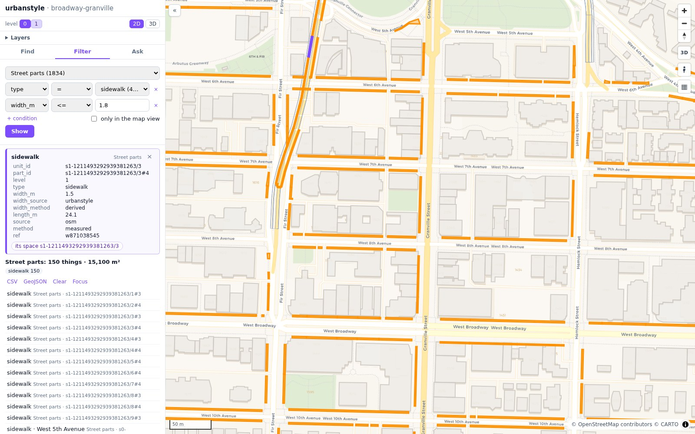
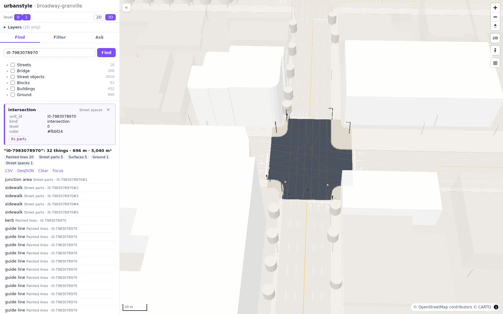
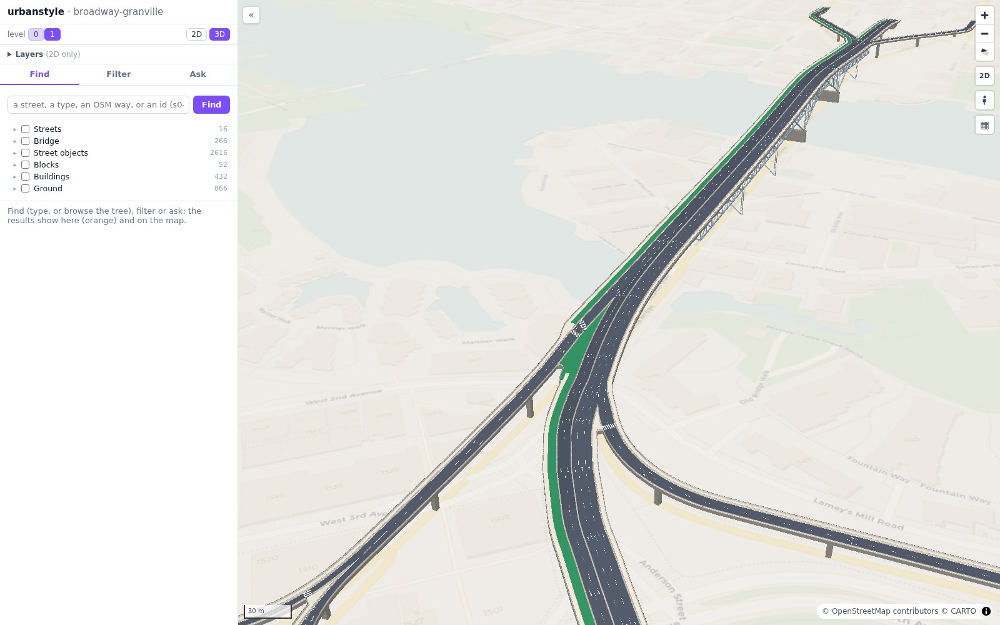

# The dashboard

One page to look at the street space of an area: find, filter and ask, in 2D and in 3D.

`urbanstyle serve` opens an area in the browser. The panel on the left gets lists of things in three ways, and the map shows them,
as a plan in 2D or as the street at its real size in 3D. Every thing in the map can be selected, and its card shows all its fields
and where each one comes from.

<small>Find → Streets → Granville Street. The panel lists the street's 14 spaces; with **Focus**, the street keeps its colors in 3D and everything else is faint.</small>

## Find, filter and ask

- **Find** searches names, types and ids in every layer. Under the search box, the area's tree lists the streets with their sections,
  intersections and parts, the bridge by axis, the street objects by kind, the blocks, the buildings by level and the ground.
  Tick boxes put a list together from any parts of the tree.
- **Filter** sets conditions on the fields of one layer: for example the sidewalks narrower than 1.8 m.
- **Ask** takes a question in plain words. An AI agent answers from the area's data only, shows the queries it used, and shows the
  things it talks about on the map.

<small>Filter → Street parts, `type = sidewalk` and `width_m <= 1.8`. The results are orange; the selected sidewalk is deep purple, and its card is in the panel.</small>

## One rule for colors

| What | Look |
|---|---|
| a list from Find, the tree, Filter or Ask | orange; everything else keeps its colors |
| the one selected thing | deep purple, with its card in the panel |
| the thing under the mouse | light purple |
| a selected section, intersection or block, or a list with **Focus** | its things in their own colors, the buildings that frame it solid, everything else faint |
| painted lines, arrows, guide lines and crosswalks | always in their own colors |

**Clear** and closing the card bring everything back.

## 3D at real size

In 3D every lane, sidewalk, kerb, painted line and street object stands at its real size, and every building at its real height.
A selected space is in focus: its parts and the objects that stand in it keep their colors. The buildings that frame it (the front
row, seen from the space within 10 m) stay solid, and the other buildings are see-through. A selected street object is seen along
its street, with the buildings see-through, so that no building hides it.

<small>One intersection in focus: its junction area, sidewalks, kerbs and the lane-to-lane guide lines in color.</small>

## Levels

Each level has a button with three looks: full, faded and hidden. The levels combine, so a street under a bridge can be seen
through the bridge, or the bridge can stand out over a faded ground.

<small>Level 0 faded, level 1 (Granville Bridge) in full.</small>

## Bridges

A bridge is drawn from its profile: its axes and lanes, its paths and barriers, its heights from LiDAR, its piers and its steel truss.

<small>Granville Bridge over False Creek, from its profile with LiDAR heights.</small>

## Try it

- Open an area: [Use the dashboard](how-to/use-the-dashboard.md).
- Ask questions: [Ask questions](how-to/ask-questions.md).
- More pictures: [Gallery](gallery.md).
