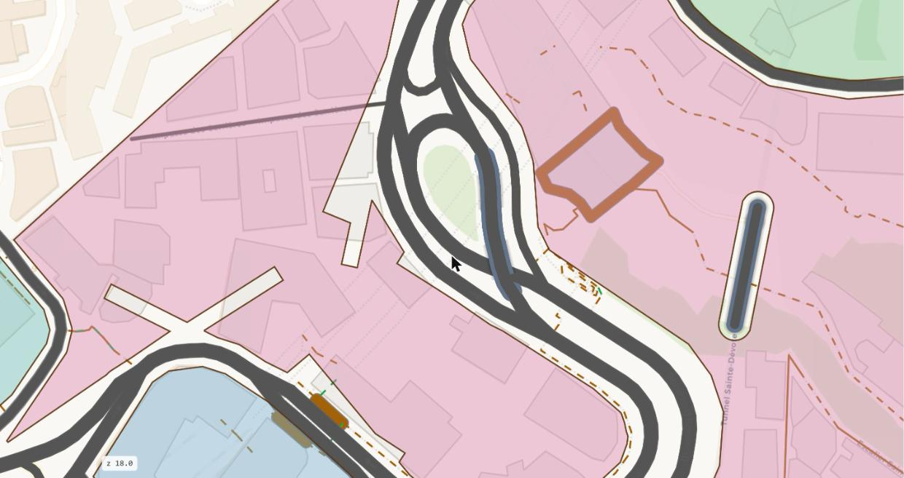
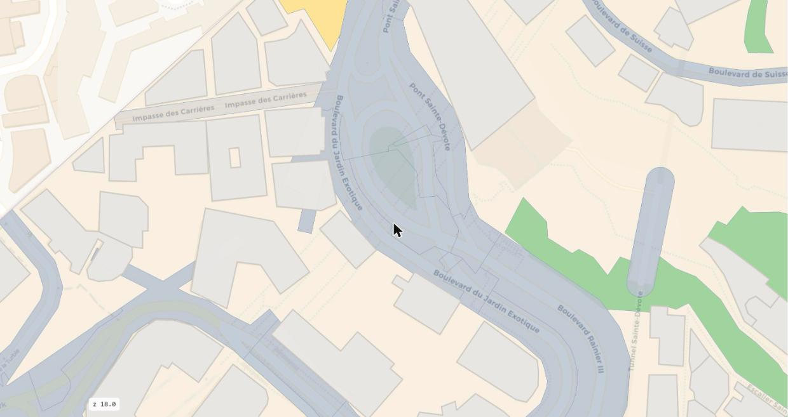

# Rank 1: the ground

The whole area of a level, cut into three kinds: the plots (the blocks), the paths (the corridors) and the street,
what is left between them. Inside a plot, its pieces are rank 2.

## Reads

The edge of the area (`urban.area`). OSM's roads, walkways, buildings, land use, water and rail, as duckOSM gives them
(`urban.element`, the feature layers).

## The blocks

A block is the land between the streets and the pedestrian ways. `blocks.py` builds the blocks in these steps.

1. **The bounding lines.** A street is a road of one of the eight street classes (motorway to living street) with its links, or a
   service road that carries a street's name and no service kind. A pedestrian way is a pedestrian street, a footway, steps or a path
   at level 0, named or not, that is not a crossing, not a sidewalk and not a pedestrian area. A road on a deck of level 1 bounds
   blocks only where nothing of level 0 passes under it. Alleys, driveways, parking aisles and rail bound no block.
2. **The chains and the faces.** The bounding lines are joined end to end between junctions, with their small wiggles taken out
   (simplified by 1 m). The chains and the edge of the area are polygonized: the faces.
3. **One edge per street side.** On each side of each road chain the block's edge follows OSM's sidewalk line, 1 m behind it, with
   the line's own shape, to the junction and round the corner as the line curves. The edge is measured every 2.5 m with a line square
   to the road; a sidewalk line counts when it runs along the road (within 35 degrees) and lies at most 8 m beyond the carriageway. A
   side needs at least three such hits. Without them the edge stands 1.5 m behind the carriageway. A building that stands nearer than
   the edge pulls the edge in to its wall, but only by more than 1.5 m, because OSM often draws a building by its roof. Past the end of
   a chain the edge runs on to the next road's edge, so two edges meet in a corner where no sidewalk line is mapped.
4. **The roads' blocks.** From each face the roads' strips are cut, and the carriageways. What is left, less its parts narrower than
   8 m, is a block if it is at least 400 m². A narrower or smaller piece, the strip between a divided road's carriageways, is street.
5. **The paths cut the blocks.** Each pedestrian way's strip is cut from the blocks: as wide as OSM's `width`, else 4 m for a
   pedestrian street and 3 m for a footway, steps or a path. The strip is square where it meets another chain and round at a dead end.
   Every piece a path leaves is a block. A piece under 10 m² or narrower than 2 m joins the corridor beside it.

A pedestrian way that runs along a road inside the road's sidewalk zone over half its length is that road's sidewalk, not a path. The
sidewalk zone is the carriageway, OSM's lanes of 3 m each, widened by 8 m on each side.

Each street side of a block keeps its distance from the road line and what set it: sidewalks, carriageway, path width or building
(the plot's `sides`).

{ width=100% }

*The blocks: the land between the streets. The street is the area less the blocks.*

## The corridors

Each pedestrian way's strip, up to the edge of the street, is its corridor, `c0-w<way>`. The corridor ends at the
street's edge, so the walking side of the street runs on past the path's mouth. A corridor is the ground item of kind `path`,
`g0-path-c0-w<way>`.

## The street

The area less the blocks and the corridors is the street of the level: one ground item per connected piece, `g0-street-<n>`. Rank 2
cuts it into its stretches ([Rank 2](stretches.md)).

## The pieces of a plot (rank 2)

Inside a block, `ground.py` gives every piece a kind, in this order of precedence. Each kind takes only the ground that no earlier
kind took.

1. `building`: each building whole.
2. `water`: OSM's water areas.
3. `rail`: OSM's railway corridors and a rail line's own bed.
4. `square`: OSM's pedestrian areas (`highway=pedestrian` with `area=yes`, the way's own polygon) and squares.
5. `structure`: the ground under a deck (OSM's `man_made=bridge` outline, or the ground under a street space of a higher level).
6. `green`: parks, playgrounds, pitches, recreation grounds, woods.
7. `alley`: a service road inside the block, the road's line widened to OSM's `width`, else 6 m.
8. `car park`: an off-street car park (an element of kind `lot`); `construction site`.
9. `green`: grass, gardens and allotments.
10. `yard`: the rest.

All outlines are noded and polygonized as one planar partition. Each face goes to the first kind in the order that holds its inner
point. A face that no kind holds joins the neighbouring face it shares the most edge with. The faces of each item are merged. A
square and a green are only what a source maps as one. Each piece names its block.

{ width=100% }

*The ground: every piece of the area at level 0 is street, plot or path; inside a plot, its pieces.*

## What lies inside a block

A block divides land, not traffic. Its edge is where the public street ends. Whatever is not a public street lies inside a block,
even where one can drive through it from one street to another.

- OSM's tag decides: a parking aisle, a driveway and a back lane (`service=*`) lie inside a block. A way tagged as a public street
  divides the block, also where it runs through a car park.
- An off-street car park is a piece of its block. A multi-storey car park is a building. An underground car park is at level -1, with
  its ramps as links.
- Parking in the street is a strip of the roadway (rank 5), not a piece of a block.
- A car park or a lane that opens onto two streets connects them. The connection is a driveway across the walking side of each
  street, and the block stays whole.

## The surfaces

Each ground item is covered exactly by its surfaces (`urban.surface`, id `<ground>:<kind>`):

| Ground item | Surfaces |
|---|---|
| street | roadway, pedestrian realm, median (from the parts of its spaces); verge where OSM maps grass in the street |
| path | path |
| building, car park, construction site | its own kind |
| yard | garden where OSM maps one; yard, the rest |
| green | play (playgrounds, pitches), path (its footpaths, 2 m), lawn, the rest |
| rail | track bed |
| structure | under bridge |
| square | paved |
| water | water |

What no source names in a street or a green joins the surface it shares the most edge with.

## Writes

`urban.ground`: one row per item of rank 1, the street, each plot with its street sides, each path. `urban.plot_piece`: the pieces of
each plot. `urban.surface`: the surfaces of each item ([The tables](tables.md)).

## Checks

| Check | Tests |
|---|---|
| G1 | no piece of ground has an unknown kind |
| G2 | no two ground items overlap by more than 0.05 m² |
| G3 | the area less the union of the kinds is under 1 m² |
| L1 | the surfaces of a ground item cover it (within 3 % or 1.5 m²) |
| L2 | the surfaces of one ground item do not overlap by more than 0.5 m² |
| B1 (INFO) | the buildings that reach over the edge of a block, drawn whole |
