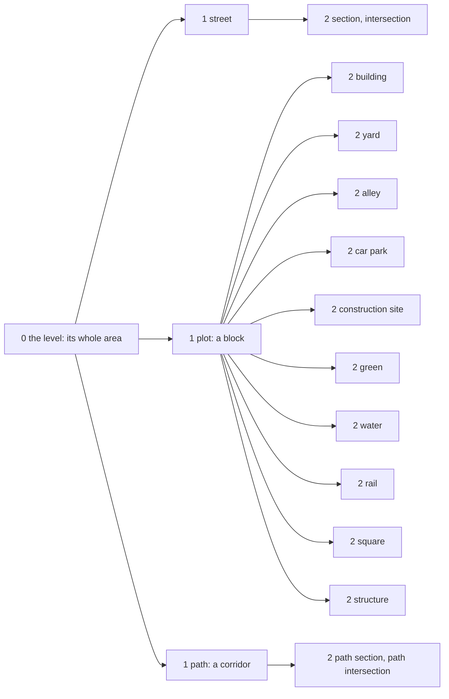
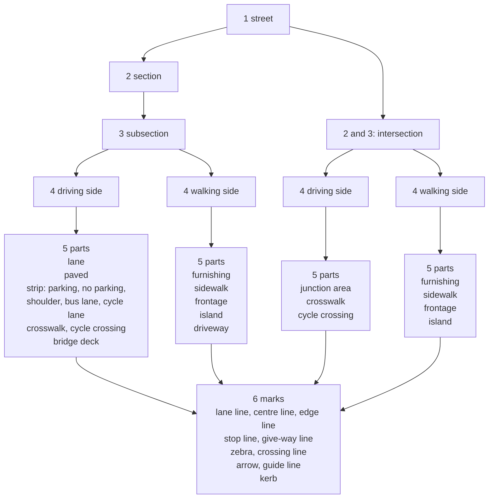
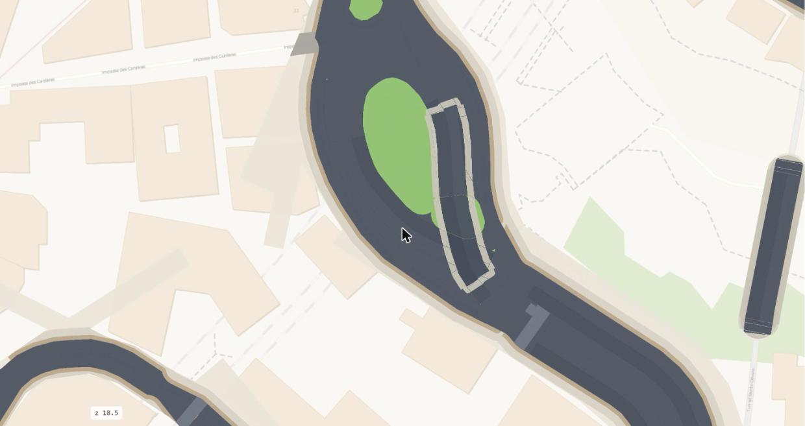
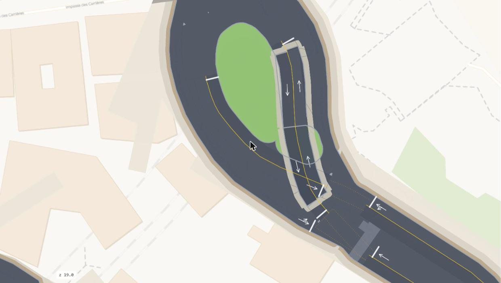
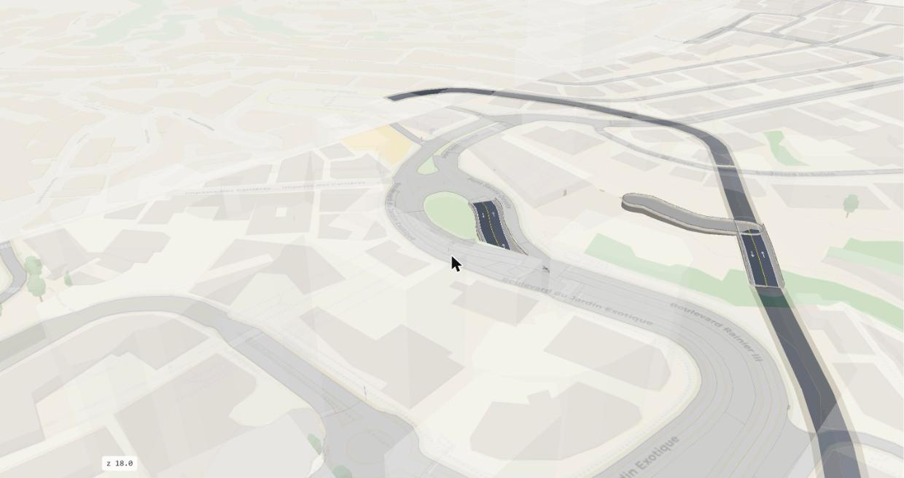

# The model

The street space of a level as a hierarchy of six ranks, from the whole area down to the painted lines.

## The ranks

Everything of the street at one level is inside one tree. Each rank is a kind of object with its own id and its own geometry. Each
rank partitions the rank above it: a thing of a lower rank is always inside one thing of the rank above, never in two and never in
none. The checks test the partition at every rank.

| Rank | Thing | Id | Table |
|---|---|---|---|
| 0 | the level: its whole area | | `space.area`, `space.element` |
| 1 | the ground: the street, a plot (a block) or a path (a corridor) | `g0-<kind>-<ref>` | `space.ground` |
| 2 | a stretch of the street: a section or an intersection; a stretch of a path: a path section or a path intersection; a piece of a plot: building, yard, alley, car park, construction site, green, water, rail, square, structure | `s0-w<way>`, `i0-<node>`, `p0-w<way>`, `q0-<node>`, `g0-<kind>-<ref>` | `space.stretch`, `space.plot_piece` |
| 3 | a unit: a subsection or an intersection | `s0-w<way>/<k>`, `i0-<node>` | `space.unit` |
| 4 | a side of a unit: the driving side or the walking side | `<unit>:d`, `<unit>:w` | `space.side` |
| 5 | a part of a side | `<unit>#<n>` | `space.part` |
| 6 | a mark on a part | | `space.mark`, `space.turn` |

The ground, rank 0 to rank 2: the whole area cut into three kinds, each divided further at rank 2.

The street, rank 1 to rank 6: the street kind divided down to the marks.

A section is divided into subsections. An intersection is never divided: it is its own stretch and its own unit, and it belongs to
no section. A plot's pieces end at rank 2. A path is a street for walking and has the same ranks as the street: path sections and
path intersections at rank 2, one unit each at rank 3, one side at rank 4 (the walking side), its parts at rank 5, and no marks.

## The tables by rank

One table per rank. Every row names its parent in the rank above (`parent_id`), and the rows of one parent partition it.

| Rank | The thing | The table |
|---|---|---|
| 0 | the area; the elements (roads, walkways, buildings, rail) | `space.area`, `space.element` |
| 1 | the street, the plots, the paths | `space.ground`: one row per item, three kinds |
| 2 | a section, an intersection; a path section, a path intersection | `space.stretch` |
| 2 | a plot's piece: building, yard, alley, car park, construction site, green, water, rail, square, structure | `space.plot_piece` |
| 3 | a unit: a subsection, an intersection, a path's unit | `space.unit` |
| 4 | a side: the driving side, the walking side | `space.side` |
| 5 | a part | `space.part` |
| 6 | a mark; a turn | `space.mark`, `space.turn` |

The [Tables](../reference/tables.md) reference lists the columns of each table.

Three things lie on the tree and are not ranks:

- **The named street** (`k0-<way>`, `space.street`) is a group of stretches: the sections that share a name and a node, with the
  intersections they arrive at. An intersection belongs to every named street that arrives at it.
- **The street objects** (`space.object`) stand on the parts.
- **The links** (`space.link`) join two elements of different levels at a node.

## The construction, rank by rank

The build makes each rank from the rank above it. The chapters of this design give each step in full.

| From | To | The step |
|---|---|---|
| rank 0 | rank 1 | the roads and the pedestrian ways cut the area into blocks and corridors; the street is the rest |
| rank 1 | rank 2 | the street: the junction nodes of the road network, the sections between them, the subsections where the paint changes; the plot: its pieces take their ground in an order of precedence |
| rank 2 | rank 3 | the street cut by every stop line and every joint; each face is one unit |
| rank 3 | rank 4 | the kerb inside each unit, from the sidewalk line or from the lanes; the driving side inside it, the walking side outside |
| rank 4 | rank 5 | the lanes, the strips and the junction area in the driving side; the sidewalk, the furnishing zone, the frontage, the islands and the driveways in the walking side |
| rank 5 | rank 6 | the kerb line, the lane lines, the stop lines, the crosswalk bars, the arrows and the guide lines |

{ width=100% }

*The sections (blue) and the intersections (red) of a street.*

{ width=100% }

*The units with their parts: the driving side in grey, the junction areas in orange, the walking side in greens.*

{ width=100% }

*The marks on the parts: lines, zebras, arrows, guide lines, the kerb.*

## The levels

A **level** is an integer floor of the area: 0 is the ground, 1 is one floor above, -1 is one below. The model keeps the levels -2 to
2. Each element gets one level span from OSM's `layer` tag. Without a tag, a bridge is level 1 and a tunnel is level -1. A level
outside the kept range is clamped to the nearest kept level. A building spans its floors. The source of the level is kept
(`level_src`: layer, bridge, tunnel, chosen).

- A road or path above the ground is a **deck**, what a **bridge** carries. A road or path below the ground is a **tunnel**. The area
  of a deck or a tunnel is a **tube**: its roadway and a narrow walkway, with no blocks.
- A tunnel meets the ground at a **portal**. A deck meets the ground at a **landing**.
- A road of level 1 is on the ground where nothing of level 0 passes under it. A road of level -1 is never on the ground: a tunnel's
  lanes stop at the portal node, and the ground's lanes start there.
- A **link** joins two elements of different levels at a shared node: a ramp, stairs, an elevator, an entrance, or a plain connection
  where a road's level changes. The links are the only joins between levels. A unit never spans two levels.
- The blocks come from the street lines of level 0 and the level-1 roads on the ground. A tunnel never bounds a block. The ground is
  level 0 only.

{ width=100% }

*The levels in 3D with level 0 faded: a tunnel's lanes under the ground, a deck above it, a bridge model at its profile's heights.*

## The words

One word per thing in the code, the ids, the tables and the documents. The third column gives the other words that readers from OSM,
SUMO or the street use for the same thing.

| The thing | Our word | Also called |
|---|---|---|
| the integer floor of the area | **level** | layer (OSM's tag), storey |
| a position in the hierarchy | **rank** | tier |
| the floor 0 | **ground** | at grade, street level |
| a road or path above the ground | **deck** | overpass, viaduct |
| the structure that carries a deck | **bridge** | |
| a road or path below the ground | **tunnel** | underpass, cut-and-cover |
| the area of a tunnel or of a deck | **tube** | |
| the node where a tunnel's way meets a ground way | **portal** | mouth |
| the node where a deck's way meets a ground way | **landing** | abutment, ramp foot |
| a ramp, stairs, an elevator, an entrance or a connection between two levels | **link** | |
| a set of things the page draws and the panel switches | **map layer**, **overlay** | |
| an OSM node where roads meet and the traffic has to decide | **junction node** | node, junction |
| the unit where the arms of one or more junction nodes meet | **intersection** | junction, crossing, roundabout |
| a road from one intersection to the next | **section** | block face, link (in traffic models) |
| a piece of a section with one cross-section | **subsection** | segment |
| the area of a subsection or of an intersection, block edge to block edge | **unit** | street space, right-of-way |
| a named road with its intersections | **named street** | street |
| one OSM way with one cross-section, between two junction nodes | **run** | edge |
| where two subsections of a section meet | **joint** | |
| a road under 40 m or a `_link` between two junction nodes, inside an intersection | **connector** | internal edge |
| a run that ends at a junction node | **arm** | approach, leg |
| how far the other arms' lanes overlap an arm from its node | **core** | |
| the line across an arm where its roadway ends and the intersection begins | **stop line** | |
| a line across the street where one unit ends and the next begins | **cut** | |
| one width for a whole section: its lanes and strips at its widest place | **frame** | cross-section, profile |
| the lanes, the paved roadway and the strips | **roadway** | carriageway, travelway |
| a band beside the lanes with a source: parking, bus, cycle | **strip** | |
| the boundary between the roadway and the walking side | **kerb** | curb |
| the roadway, kerb to kerb | **driving side** | travelway |
| the unit less the roadway, kerb to block edge | **walking side** | pedestrian realm |
| the three bands of the walking side, from the kerb | **furnishing**, **sidewalk**, **frontage** | furniture zone, clear path, building zone |
| a piece of the walking side between two roadways, touching no block | **island** | refuge, median |
| a band across the roadway on a crossing way | **crosswalk** | zebra, pedestrian crossing |
| a service road's crossing of the walking side | **driveway** | apron, alley mouth |
| one piece of a side, of one type | **part** | polygon, feature |
| a painted line, an arrow, a zebra, or the kerb line | **mark** | marking |
| the land between the streets | **block** | |
| the edge of a block where it faces a street | **block side** | |
| a pedestrian way's own ground between the blocks | **corridor** | |
| a reading of the kerb's place from a city's data | **kerb evidence** | |
| where OSM's tags change along a section, with its class | **change** | |

## The ids

An id is stable: it comes from what a thing is, never from the build order. A rebuild on the same data gives the same ids.

| Thing | Id | Example |
|---|---|---|
| a block | `b<level>-w<way><side>` | `b0-w23189661l` |
| a corridor | `c<level>-w<way>` | `c0-w159170500` |
| a ground item | `g<level>-<kind>-<ref>` | `g0-plot-w37127121` |
| a section | `s<level>-w<way>`, a second chain of the same way `.2` | `s0-w473754701.2` |
| a subsection | `<section>/<k>` | `s0-w473754701.2/2` |
| an intersection | `i<level>-<node>` | `i0-11102738098` |
| a path section, a path intersection | `p<level>-w<way>`, `q<level>-<node>` | `p0-w159170500` |
| a plot's piece | `g<level>-<kind>-<ref>` | `g0-building-w49209427` |
| a side | `<unit>:d`, `<unit>:w` | `s0-w473754701.2/2:w` |
| a part | `<unit>#<n>` | `s0-w473754701.2/2#10` |
| a named street | `k<level>-<way>` | `k0-473754701` |
| a street object | `n<node>`, `w<way>` | `n13983466896` |
| a link | `<node>` | |

[The tables](tables.md) gives each table with its columns; the [Ids](../reference/ids.md) reference lists every scheme with the code
that makes it.
