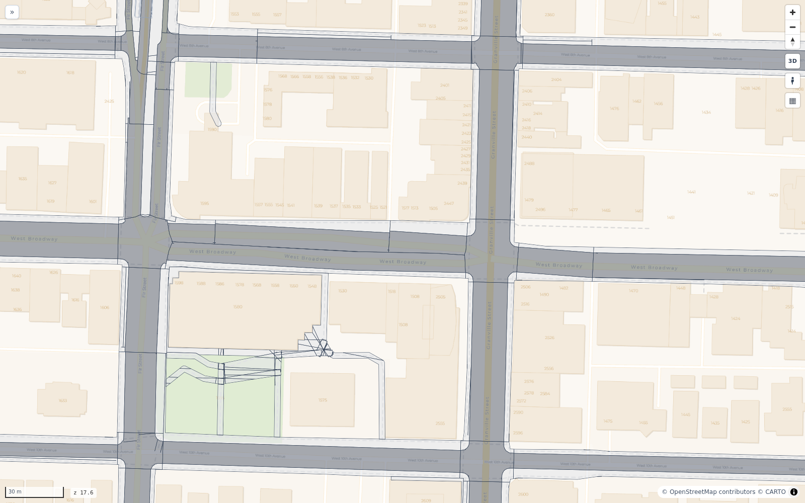

# Ranks 3 and 4: the spaces and their sides

The street of rank 1 cut into spaces, one per subsection and one per intersection, by the stop lines and the joints
alone. Inside each space the kerb splits the driving side from the walking side.

## Reads

The street polygon of rank 1. The axes, the junctions and the change classes of rank 2. OSM's lanes, widths and sidewalk lines. OSM's
parking and cycle lanes, a city's meters and kerb evidence.

## Rank 3: each stretch cut into its spaces

1. **An intersection** is one space: its face of rank 2, with its corners.
2. **A section** is cut by its joints: each joint between two subsections is run square to the road across the section's face, to
   its edges on both sides. The section's face noded with these cuts and polygonized gives its subsections, each one face. A section
   with no joint is one subsection.
3. **A cut** is clipped to the face it cuts and passes the face's boundary by 1 cm, so the noding joins them.

The space of rank 3 is the face (`urban.space`): a subsection, `s0-w<way>/<k>`, or an intersection, `i0-<node>`. The subsections of a
section partition the section; the spaces of the level partition the street.

**The axis.** A subsection's axis is the piece of its section's axis that it covers, from `s_from` to `s_to`, in metres from the
section's start. Every position inside the space is `(s, t)` on this axis: `s` along, `t` across, positive to the left.

**The links.** Each space names the spaces before and after it along the street. A subsection's predecessor and successor are its
neighbours in its section, or the intersection at the section's end. An intersection's predecessors and successors are the
subsections at its arms: the arms that come in and the arms that go out. A two-way arm is both.

{ width=100% }

*Rank 4: the driving side (grey) and the walking side (light) of each space, split at the kerb.*

**The paths.** A corridor is cut at its path junctions into one space per path section and one per path intersection; a square is
one space. A path's space has one side, the walking side, and no kerb.

## Rank 4: the kerb and the two sides

**The frame.** A section has one frame: the lanes, both directions together, plus the parking, bus and cycle strips a source gives,
at the widest place of the section. The lanes are centred on the OSM line of the way they belong to. No line is moved sideways. A
merge or a fork is the one exception: the section whose lanes are the through arm's plus the merging arm's keeps the through arm's
kerb away from the merging arm, and its lanes sit half the merging lanes' width off the OSM line (`subsection.left_extra`). Where two
ways' lines are not aligned, the lanes jog inside the frame and the frame does not.

**The lane width.** Each lane is 3.25 m, a chosen value, or OSM's `width` shared by its lanes, between 2.5 m and 4.5 m. The lane
count is OSM's `lanes`, per direction from `lanes:forward` and `lanes:backward`. A two-way road with no count has one lane each way.
Where no source gives a lane width and the city's catch basins lie beyond the chosen lanes by 0.3 m to 3 m on a side, the outer lane
on that side widens to them as a lane that holds parking.

**The room.** The street's edge of rank 1 caps every kerb. For each run, the room on each side is the least distance from its line to
the blocks, the corridors and the sidewalk strips, measured every 2.5 m out to 60 m. The frame's kerb on that side never passes it.
Where the lanes and the strips do not fit between the two edges, the chosen lane width narrows on that piece, down to 2.75 m, the
count as OSM maps it (`width_method` `narrowed`). A width OSM maps is not narrowed. What still does not fit is cut at the edge. A joint
where the room changed the frame is the change class `room`.

**The sidewalk strip.** Every walkway at level 0 that is no crossing and has no corridor is a sidewalk line. Its strip is OSM's `width`
or 2 m, centred on the line. The near side of the strip is the kerb's limit; the far side is the block's edge. At a corner the kerb is
the line's curve where OSM maps it, and a 4 m fillet only where it does not.

**The driving side** is the part of the space inside the kerb: in a section the frame between the two stop lines, in an intersection
the roadways of the arms to their stop lines, with the connectors' carriageways, joined, with the corners at the kerb.

**The walking side** is the rest of the space, with the corners. A piece of the walking side that touches no block is an island of
that space. An island begins where the strip between two frames is 2 m wide; a thinner tail with nothing on it is paved roadway, cut
off square. Inside an intersection a paved strip between roadways is junction area.

Every space, with its parts and marks, is cut from the street of rank 1: the blocks and the corridors are taken out. So a space never
reaches into a block.

## Writes

`urban.space`: one row per space with its kind, its stretch, its axis and its range on the section's axis, its predecessors and
successors, the frame's width and the merge shift. `urban.side`: the
driving side and the walking side of each space, the driving side with its kerb; an island is a part of the walking side ([The
tables](tables.md)).

## Checks

| Check | Tests |
|---|---|
| U1 | no two spaces overlap by more than 0.05 m² |
| U2 | every space is one valid polygon |
| U14 | the spaces add up to the street, with a gap under 1 m² |
| B7 | no space reaches into a block by more than 0.05 m², past a 2 cm hairline |
| B8 (INFO) | the spaces whose lanes narrowed to fit between the street's edges |
| S1 | the two sides of a space add up to the space, with no overlap |
| R1 | the roadway's edge steps at a joint only at a real change or a room change |
| A1 | the middle of a carriageway's lanes lies within 0.5 m of its OSM line |
