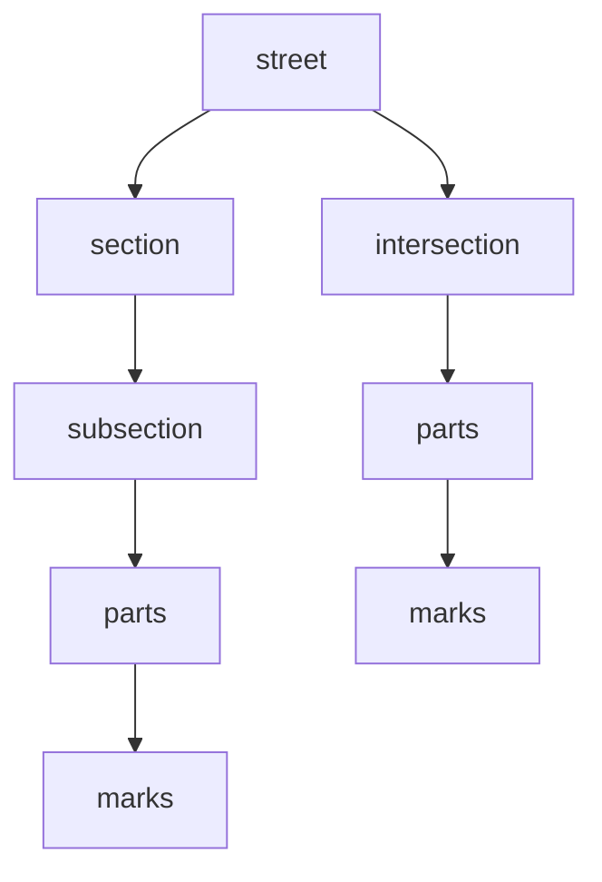
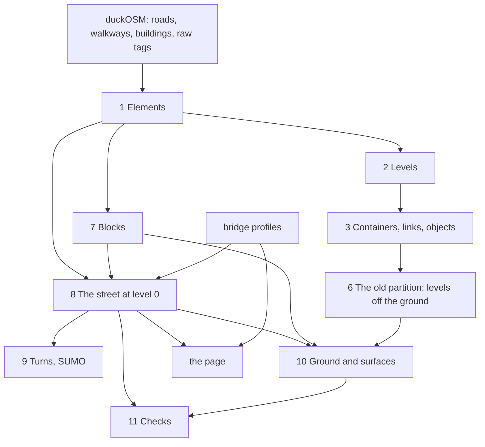
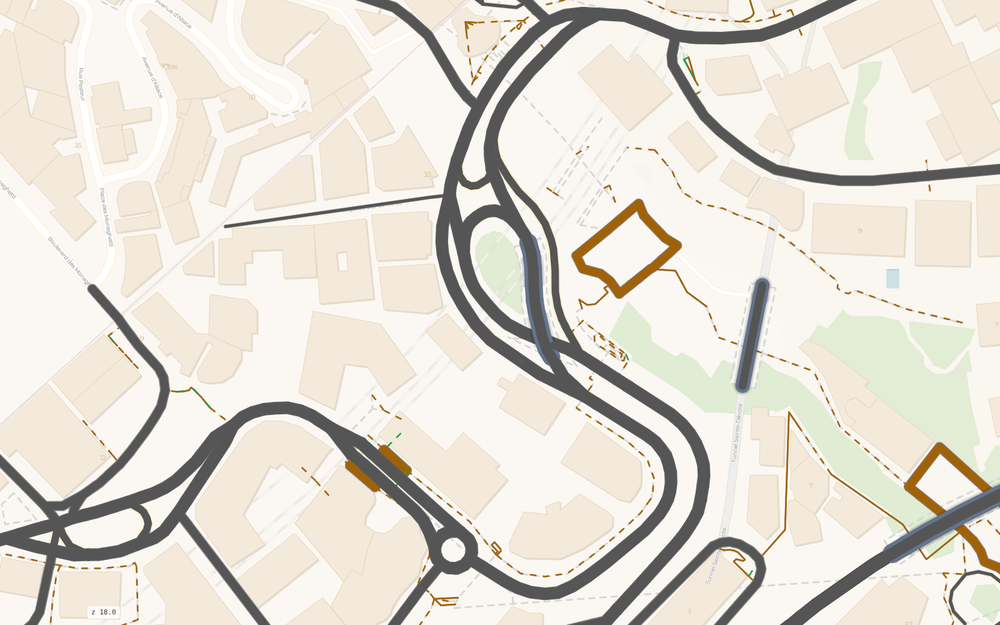
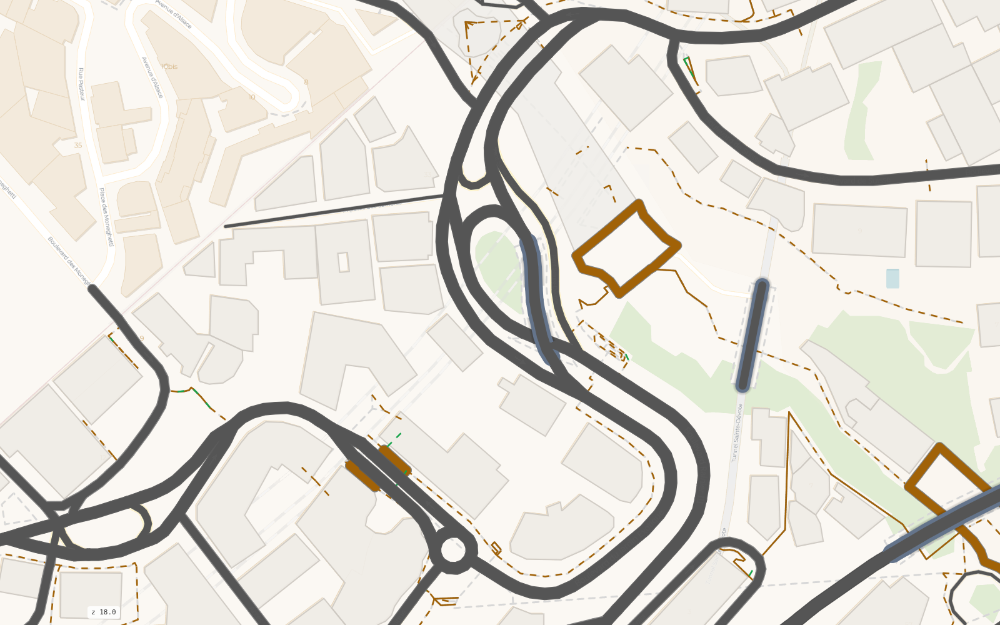
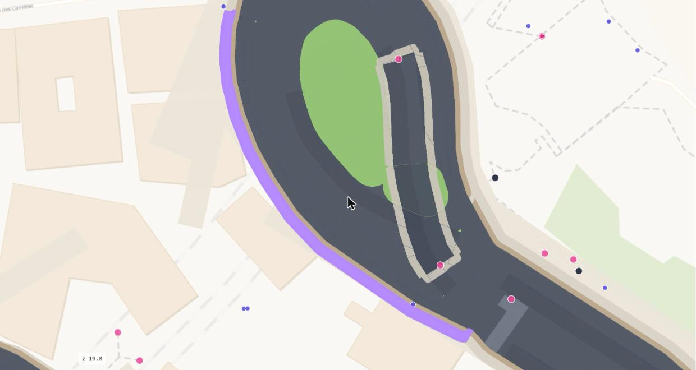
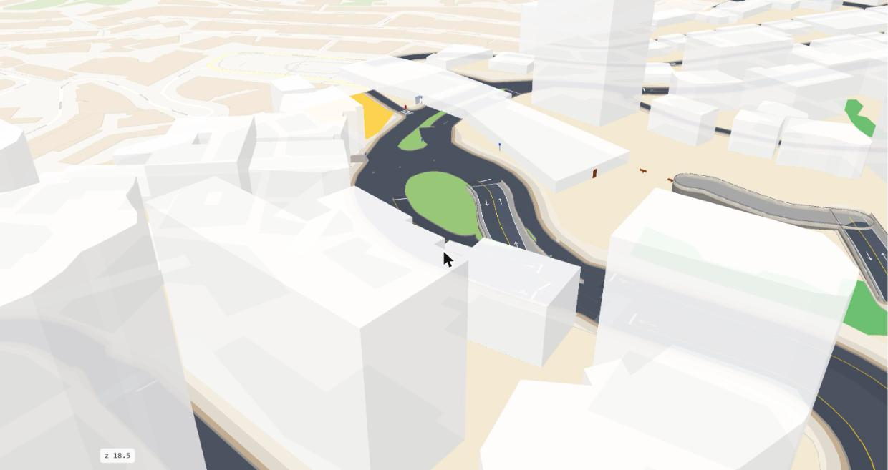
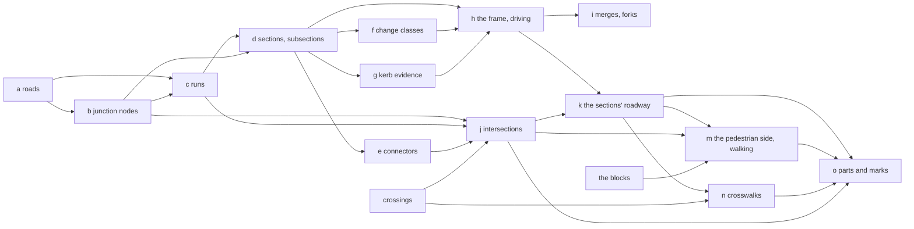

# The street model: its hierarchy, the steps that make it, and what depends on what

Status: written 2026-10-16 from the code (`container.build`, `network.build`). It is the map of the model and of the pipeline: what
each thing is, how it is detected, what each step reads and writes, and what depends on what. The rules themselves are in
`street-rules.md`, `sections.md`, `junctions.md`, `blocks.md`; the order of work in `plan.md`. When a step changes, change this
file with it.

The pictures come from the Monaco dashboard at one place, the Sainte-Dévote roundabout with its bridge over the ravine, Boulevard
Rainier III and Boulevard du Jardin Exotique (`?at=7.41925,43.73790`), each with the layers of one step switched on. Every picture
is a screenshot of the page, never a separate drawing.

## 1. The hierarchy, and how each thing is detected

Everything of the street at one level is inside this tree. A thing of a lower rank is always inside one thing of the rank above,
never in two and never in none.

**1. The street**, id `k0-<way>`, table `space.street`.
What: a named road with the intersections it arrives at.
How: the sections that share a name and a node are one street. An unnamed road is its own street.

**2. The section**, id `s0-w<way>` (or `s0-w<way>.n` when one way gives two sections), table `space.subsection` (its pieces).
What: the road from one junction to the next, whatever OSM ways it is made of.
How: first the junction nodes: an OSM node with 3 or more road ends (a road through counts 2), where a road ends, two ends merge
or fork, or two streams cross (rules 1-2, 13). Then the runs, one OSM way with one cross-section, are chained end to end across every
node that is no junction. The chain is the section, named by its longest way.

**3a. The subsection**, id `s0-w<way>/<k>`.
What: a piece of a section with one cross-section (the same lanes and strips all along it).
Where: its line, the piece of the road's centre line, is in `space.subsection` with the frame's width, the strips and `left_extra`;
its area, from block edge to block edge, is in `space.unit` under the same id. One object, two geometries.
How: the section is cut where its lanes or its strips change. Each cut is a joint, classed `real`, `none`, `fork`, `merge`,
`parking` or `unknown`; only a `real` change changes the section's frame (`sections.md` section 3, rules 5-8).

**3b. The intersection**, id `i0-<node>`, at the same rank as the subsection.
What: the space where the arms of one or more junction nodes meet.
Where: its nodes are in `space.junction`; its area in `space.unit`.
How: for each junction node, its arms are the runs whose line ends at it. Each arm reaches to its stop line: the far edge of a
crossing within 15 m, else 3 m past where the other arms' lanes overlap it. The arms' frames to there, with the connectors (a road
under 40 m or a `_link` between two junction nodes, rule 3), joined where they touch, corners rounded by 4 m, make the intersection
(rules 4, 5, 15).

The area of a subsection or of an intersection is its roadway plus the pedestrian side given to it: the street (the area less the
blocks) less the roadway, each piece to the nearest roadway, cut at the arms' stop lines and at the block corners. The word
"space" means this area (`space.unit`); it is not a rank of its own.

**4. The parts**, id `<space>#<n>`, table `space.part`, inside one subsection or one intersection.
What: a partition of the whole area of the subsection or of the intersection. Every point of the area lies in exactly one part: the
driving parts and the walking parts together cover it with no overlap (checks U8, the parts add up to the space, and U9, no two
parts of a space overlap).
Driving side, built from the road's line outward: each lane is a band 3.25 m wide (or OSM's `width`), laid side by side from the
frame's right edge to its left edge, centred on the carriageway's OSM line, as many as OSM counts; where the frame is wider than the
lanes the rest is paved roadway (`carriageway`); a parking, bus or cycle strip is a band outside the lanes where a source gives it;
in an intersection the junction area is the arms' frames to their stop lines plus the connectors; the crosswalks, bands as wide as
the crossing on OSM's crossing ways, are cut out of all of them.
Walking side, built from the kerb outward: the area less the roadway. Along the roadway's edge, the kerb, the first 1.0 m is
furnishing, the next 1.8 m is the sidewalk (the clear path), the rest up to the block's edge is frontage; the three widths are
chosen values (`FURNISH_M`, `CLEAR_M`). A driveway, as wide as its service road or 5 m, is cut across them where a service road
reaches the roadway. A piece that touches no block, between two roadways, is an island.
The types (`space.part.type`), at level 0: driving side `lane` (its direction in a column: forward, backward, both, in, out),
`carriageway` (paved roadway with no lane), `junction area`, the strips `parking`, `no parking`, `shoulder`, `bus lane`,
`bus zone`, `cycle lane`, the crossings `crosswalk` and `cycle crossing`, and `bridge deck` (a bridge way's band, its lanes drawn by
the bridge model); walking side `furnishing`, `sidewalk`, `frontage`, `island`, `driveway`. Only at the levels the old partition
still builds: `ring` and `lane circulating` (a roundabout's ring), `verge`, `open`, `bus stop`, `tree pit`, `parking lot`.

**5. The marks**, table `space.mark`, on the parts.
Lane lines only between lanes OSM counts, the centre line, stop and give-way lines at the stop lines, zebras from
`crossing:markings`, arrows and guide lines from SUMO's moves, the kerb line between the two sides.

Outside the tree: the **blocks**, which bound the spaces from outside and belong to the plots (`blocks.md`); the **links** between
levels, which join two elements at a node; the **bridge models**, drawn from a profile over the level-1 spaces they replace.

On the page the layers follow the tree: **Sections** draws each section's area (its subsections' areas joined), **Subsections** each
subsection's own area (`space.unit`), **Subsection axes** and **Subsection breaks** the subsections' lines and where each starts
(`space.subsection`), **Intersections** the intersections' areas, **Parts** the parts, **Mark: ...** the marks, **Blocks** the blocks.

{ width=100% }

*The sections (blue) and the intersections (red) at Sainte-Dévote. The roundabout and its neighbours are one intersection, i0-25197679, by rule 3 as it stands.*

{ width=100% }

*The subsections of the sections, with the breaks where the cross-section changes and each one's axis.*

{ width=100% }

*The spaces with their parts: the driving side in grey, the junction areas in orange, the walking side in greens.*

{ width=100% }

*The marks on the parts: lines, zebras, arrows, guide lines, the kerb.*

## 2. The build (`container.build`), in order

The whole in one picture:

The steps:

| # | Step | Reads | Writes | Rules |
|---|---|---|---|---|
| 1 | **Elements** (`BUILD`, `ROADS`, `RAIL`, `LOTS`) | duckOSM: the driving, walking and cycling edges, the raw ways and nodes, the feature layers | `space.element` (buildings, roads, walkways, cycleways, rail), `space.lot` | `street-space.md`; a parking aisle and a driveway are no road |
| 2 | **Levels** (`CLAMP`) | the elements' `layer`, `bridge`, `tunnel` tags | `level_min`, `level_max`, `level_src` of each element; levels outside `LEVELS` clamped | `space-layers.md` |
| 3 | **Containers** (`CONTAINER`, `STATIONS`, `LINKS`, `OBJECTS`) | the elements | `space.container`, `zone`, `street`, `arm`, `station`, `link`, `object` (the old street spaces, kept for the levels off the ground and for the links between levels) | `street-space.md` |
| 4 | **Strips** (`strips.build`) | the containers | `space.strip` | `street-strips-v1.md` |
| 5 | **Buildings' use** (`buildings.build`) | the buildings, OSM's shops, a city's storefronts | `use`, `ground_use` of each building | `buildings.md` |
| 6 | **The old partition** (`subsections.build`, `spaces.build`, `parts.build`) | the containers, SUMO | `space.subsection`, `unit`, `part`, `mark`, `width`, `turn` for the levels off the ground (step 9 replaces the level-0 rows) | `network-first.md`, `space-parts.md` |
| 7 | **Blocks** (`blocks.build`) | the street lines (`blocks.street_sql`), the footways, a city's parcels, the buildings | `space.block`, `block_side`, `area`, `city_block` | `blocks.md`, rules 6 and 11 |
| | *the copy `OUT.before-division`: `build --from division` starts here* | | | |
| 8 | **The street at level 0** (`network.build`), section 3 below | the elements, the blocks, the bridge profiles, duckOSM's lanes, `corrections/`, a city's kerb evidence and meters | the level-0 rows of `space.unit`, `junction`, `subsection`, `change`, `part`, `mark`, `kerb` | `street-rules.md`, `sections.md`, `junctions.md` |
| 9 | **Turns** (`turns.build`) | the subsections' lanes, the intersections, SUMO (`sumo.py`) | `space.turn`, the `guide line` and `arrow` marks | `space-parts.md` |
| 10 | **Ground** (`ground.build`, `ground.surfaces`) | the units, the blocks, the lots, water, green, rail | `space.ground`, `space.surface`, `space.parcel` | `space-layers.md` |
| 11 | **Checks** (`urbanstyle check`) | everything | the report | `street-rules.md`, the bridge rules |

The bridge profiles (`urbanstyle bridge`) come before a build of an area with bridges; the page (`urbanstyle dashboard`) after it.
{ width=100% }

*Step 1, the input: duckOSM's road lines at Sainte-Dévote. Every later step starts from these lines.*

{ width=100% }

*Step 1, the elements: the roads with the buildings, the car parks and the rail, each with its level.*

{ width=100% }

*Step 7, the blocks: the land between the streets, bounded by the footways and the parcels. The street is the area less the blocks.*

{ width=100% }

*Step 10, the ground: every piece of the area at level 0 is street, plot, green, water or structure.*

## 3. Inside the network step (`network.build`), in the order the code runs

The numbers in the code's comments (2, 3-4, 6a, 6a'', 6b, 6a', 6c, 6c', 5, 6, 7, 8a) are the numbers of `pipeline.md`'s steps,
not the order of execution. The order is this:

| | Sub-step | Depends on | Makes |
|---|---|---|---|
| a | **The road network** | the elements at level 0, and at level 1 where nothing at level 0 passes under them; `street_sql`; the bridge profiles' ways; duckOSM's lanes, OSM's tags, `corrections/lanes.json` | the edges: one line per road with its lanes forward and backward, its width, its class |
| b | **Junction nodes** | the edges | the nodes where 3 or more road ends meet and a road ends, two ends merge or fork, or two streams cross (rules 1-2, 13); a node only a bridge's ways reach is not one (`sections.md`, "Monaco", 1) |
| c | **Runs** | the edges, the junction nodes | a run: one way with one cross-section (lanes, strips), split at the junction nodes; its own lanes' band (`own`) |
| d | **Sections and subsections** | the runs, the junction nodes | a section: the runs chained end to end across the nodes that are no junction, from junction to junction, named by its longest way; a subsection: the runs of a section that have one cross-section, `/1`, `/2`, ... along it; the joints between subsections, each with its cut line (the bisector of the two directions) |
| e | **Connectors** | the sections, the junction nodes | a section between two junction nodes under 40 m, or of `_link` ways, is a connector: it belongs to one intersection with both nodes (rule 3) |
| f | **Change classes** | the subsections' lanes, `turn:lanes`, the junction nodes | each joint classed `real`, `none`, `fork`, `merge`, `parking`, `unknown` (`sections.md` section 3, check J4) |
| g | **Kerb evidence** | a city's catch basins, poles, sidewalk lines, per section | the section's kerb from the evidence, judged once for the section (rule 9) |
| h | **The frame** (driving) | the subsections of a section, the change classes, the kerb evidence | one width per section: the lanes and the strips a source gives at the section's widest place; only a `real` change starts a new frame piece, with a kerb taper (rules 5-8, 10); the carriageway band `cw`, cut at the joints |
| i | **Merges and forks** | the frames, the classes `merge` and `fork` | the section that keeps the far kerb at a merge or fork, `left_extra` (rule 14) |
| j | **Junctions** | the junction nodes, the runs' own lanes, the crossings, the connectors | for each node its arms (the runs whose line ends at it), each arm's core (how far the other arms' lanes overlap it) and stop line (the far edge of a crossing within 15 m, else 3 m past the core), its frame to the stop line; the shapes that touch and the connectors clustered into one intersection, corners rounded by 4 m (rules 4, 5, 15) |
| k | **The sections' roadway** | the frames, the intersections | each section's carriageway less the intersections, less the roadway already taken by another run |
| l | **Barriers from a bridge landing** | the bridge corrections | a median barrier continued on the ground, its strip an island (rule 12) |
| m | **The pedestrian side** (walking) | the street (the area less the blocks), the roadway, the arms' stop lines, the service roads | the street less the roadway, each piece given to the nearest roadway; the strip between two roadways an island where it is 2 m wide, paved roadway where thinner (rule 15); the sidewalk cut square at each arm's stop line and at the block corners; a driveway where a service road crosses it |
| n | **Crosswalks** | OSM's crossing ways and crossing nodes, the roadway | a crosswalk part per crossing that runs across the road, its paint from `crossing:markings` (rule 7, check X1) |
| o | **Parts and marks** | all of the above | the parts of every unit: lanes, paved roadway (`carriageway`), junction area, crosswalk, island, sidewalk, furnishing, frontage, driveway; the marks: kerb, centre, lane, stop and give-way lines (rules 8, M1) |
| p | **Write** | the parts and marks | the level-0 rows of `space.unit`, `junction`, `subsection`, `change`, `part`, `mark`; a crosswalk is one object in one space (the loser's piece goes) |
| q | **The kerbs** | the roadway, the pedestrian side | `space.kerb`: one line for the level, the boundary between the roadway and the pedestrian side |
{ width=100% }

*Sub-steps b to e and j: the junction nodes make the intersections (red) and the sections between them (blue). The roundabout and its neighbours are one intersection here, i0-25197679, by rule 3.*

{ width=100% }

*Sub-step d: a section's subsections, one per cross-section, with the breaks where the cross-section changes and the axis of each.*

{ width=100% }

*Sub-steps j and m: the cuts, square across each arm at its stop line and at the block corners: each piece of the street belongs to one section or one intersection.*

{ width=100% }

*Sub-steps h, k, m and o: the parts. The driving frame: lanes, paved roadway, junction area. The walking frame: sidewalk, furnishing, frontage, islands.*

{ width=100% }

*Sub-step o, the marks: lane, centre, stop and give-way lines, the zebras, the arrows and the guide lines through the junctions.*

{ width=100% }

*Sub-step n and build step 3: the crosswalks over the roadway, the street objects, and the links between levels (ramps, stairs, elevators).*

{ width=100% }

*The same place in 3D: the roadway flat, the sidewalks and islands raised, the painted lines, the buildings at their height, the bridge model.*

## 4. What depends on what

- The **subsections** depend on the sections (d), the sections on the runs (c), the runs on the junction nodes (b) and the edges (a).
  A change in what a junction node is (b) or in what a connector is (e) changes the sections and the subsections after it, and nothing
  before it.
- The **frame** (h), the driving side, depends on a section's subsections, their change classes (f) and the kerb evidence (g). It
  does not depend on the intersections.
- The **intersections** (j) depend on the junction nodes (b), the runs' own lanes (c), the crossings and the connectors (e). They do
  not depend on the frames: an arm's frame is read, not changed, when the arm is cut at its stop line.
- The **roadway** of a section (k) depends on its frame (h) and on the intersections (j).
- The **pedestrian side** (m), the walking side, depends on the roadway (k), the arms' stop lines (j) and the blocks (step 7 of the
  build). The blocks depend on the street lines and the footways only, never on the intersections, so a change in (b), (e) or (j)
  leaves every block where it is.
- The **crosswalks** (n) depend on the roadway (k); the parts (o) on everything; the turns (build step 9) on the subsections' lanes
  and the intersections; the ground (step 10) on the units and the blocks.

## 5. The two frames

- **Driving:** the frame of a section (h): one width for the whole section, the lanes OSM counts, centred on each carriageway's OSM
  line, plus the parking, bus and cycle strips a source gives; inside an intersection the arms' frames to their stop lines and the
  connectors' carriageways, as one junction area (j).
- **Walking:** the pedestrian side (m): from the frame's edge, the kerb, to the block's edge, as the bands sidewalk, furnishing and
  frontage (their widths in `parts.py`), with the islands between two roadways, the driveways across it, and the crosswalks over the
  roadway (n). It is cut at the arms' stop lines and at the block corners, so each piece belongs to one section or one intersection.

## 6. The levels: how the build separates them

The words (the glossary has them): a **level** is an integer floor of the area, 0 the **ground**, above it a **deck** (what a
**bridge** carries), below it a **tunnel**, each in a **tube**; a tunnel meets the ground at a **portal**, a deck at a **landing**;
a **link** joins two elements of different levels at a node. "Layer" is OSM's tag, or one of the model's layers of
`space-layers.md`, never a level.

{ width=100% }

*The levels in 3D with level 0 faded: a tunnel's lanes lie flat under the ground, a deck 6 m above it, a bridge model at its profile's heights. Each level has its own button: full, faded, hidden.*

- **Each element gets one level span** in build step 2 (`CLAMP`): OSM's `layer` when the way has one; else a bridge is level 1
  and a tunnel level -1; else level 0. A level outside `LEVELS` is clamped to the nearest kept level. A building spans its floors.
  The source of the level is kept (`level_src`: layer, bridge, tunnel, chosen).
- **Level 0 is the street of section 3.** It takes the roads of level 0, and a road of level 1 where nothing at level 0 passes under
  it: a deck over nothing is the ground's street for the blocks and for the network, and its level-1 copy from the old partition is
  removed. A road of level -1 is never on the ground, so a tunnel's lanes stop at the portal node and the ground's lanes start
  there (they touch at the node; `tunnels-3d.md`).
- **A bridge with a profile** keeps its ways in the level-0 network for one `bridge deck` part on their band, no lanes: the model
  made from the profile (`bridge3d.py`) draws the deck, its lanes and paths at the profile's heights, and the page hides the level-1
  spaces the model replaces (those on the deck's outline and those of the axes' ways). A level-1 road with no profile is drawn as a
  flat deck 6 m up, with the parts of the old partition.
- **Every level but 0** is built by the old partition only (build step 6): its containers divided into subsections and spaces, the
  parts of a tube (the roadway and a narrow walkway). The rules of section 3 do not run there yet; running the network step for every
  level is step 1 of `tunnels-3d.md`.
- **The links between levels** (`space.link`, build step 3) join two elements of different levels at a shared node: a ramp, stairs,
  an elevator, an entrance, or a plain connection where a road's level changes at a node. They are the only joins between levels; a
  space never spans two levels.
- **The blocks** are made from the street lines of level 0 and of the level-1 roads on the ground; a tunnel never bounds a block.
  The ground (build step 10) is level 0 only.
- **On the page** each level has its own layers and its own level button; in 3D a deck is 6 m a level above the ground, a tunnel lies
  flat under the ground (the map draws nothing below it), a bridge model at its profile's heights.
- **The checks** run the street rules at level 0 (A, J, X, M, K, R); the space checks (U, P, S, I, C) at every level; the bridge
  rules (BR) per profile.

## 7. The words

One word per thing in the code, the ids, the tables and the docs. The second column is the word; the third gives the other words
one hears for the same thing, so that a reader coming from OSM, SUMO or the street knows what is meant.

| The thing | Our word | Also called |
|---|---|---|
| the integer floor of the area, 0 the ground, +1 above, -1 below | **level** (`level`, `level_min`, `level_max`, the level buttons) | layer (OSM's tag, and in talk); storey |
| a position in the hierarchy: street, section, subsection and intersection, part, mark | **rank** | level (never: that is the floor), tier |
| the floor 0 | **ground** | at grade, street level |
| a road or path above the ground | **deck** | overpass, viaduct |
| the structure that carries a deck: its profile and its 3D model | **bridge** | |
| a road or path below the ground | **tunnel** | underpass, cut-and-cover |
| the space of a tunnel or of a deck: roadway and a narrow walkway | **tube** | |
| the node where a tunnel's way meets a ground way | **portal** | mouth |
| the node where a deck's way meets a ground way | **landing** | abutment, ramp foot |
| a ramp, stairs, an elevator, an entrance or a connection between two levels | **link** | |
| the model's two sheets of the ground: what each piece is, and its surface | **layer 0, layer 1** of `space-layers.md` | |
| a set of things the page draws and the panel switches | **map layer**, **overlay** (roadstyle's word) | |
| an OSM node where roads meet and the traffic has to decide | **junction node** | node, junction |
| the space where the arms of one or more junction nodes meet | **intersection** (`i0-<node>`) | junction, crossing, roundabout (a loop one) |
| a road from one junction node's intersection to the next | **section** (`s0-w<way>`) | block face, link (in traffic models) |
| a piece of a section with one cross-section | **subsection** (`s0-w<way>/<k>`) | segment |
| the area of a subsection or of an intersection, block edge to block edge | **space** (`space.unit`) | street space, right-of-way |
| a named road with its intersections | **street** (`k0-<way>`) | |
| one OSM way with one cross-section, between two junction nodes | **run** | edge (duckOSM) |
| where two subsections of a section meet | **joint** | |
| a road under 40 m or a `_link` between two junction nodes, inside an intersection | **connector** | internal edge (SUMO) |
| a run that ends at a junction node | **arm** | approach, leg |
| how far the other arms' lanes overlap an arm from its node | **core** | |
| the line across an arm where its roadway ends and the intersection begins | **stop line** | |
| a line across the street where one space ends and the next begins | **cut** | |
| one width for a whole section: its lanes and strips at its widest place | **frame** (driving) | cross-section, profile |
| the lanes, the paved roadway and the strips | **roadway** | carriageway, travelway |
| a band beside the lanes with a source: parking, bus, cycle | **strip** | |
| the boundary between the roadway and the walking side | **kerb** | curb |
| the space less the roadway, kerb to block edge | **pedestrian side** (walking) | pedestrian realm, sidewalk area |
| the three bands of the pedestrian side, from the kerb | **furnishing**, **sidewalk**, **frontage** | furniture zone, clear path, building zone |
| a piece of the pedestrian side between two roadways, touching no block | **island** | refuge, median |
| a band across the roadway on a crossing way | **crosswalk** | zebra, pedestrian crossing |
| a service road's crossing of the pedestrian side | **driveway** | apron, alley mouth |
| one piece of a space, of one type | **part** (`space.part`) | polygon, feature |
| a painted line, an arrow, a zebra, or the kerb line | **mark** (`space.mark`) | marking |
| the land between the streets | **block** | |
| the edge of a block where it faces a street | **block side** | |
| a reading of the kerb's place from a city's data | **kerb evidence** | |
| where OSM's tags change along a section, with its class | **change** (`space.change`, J4) | |
