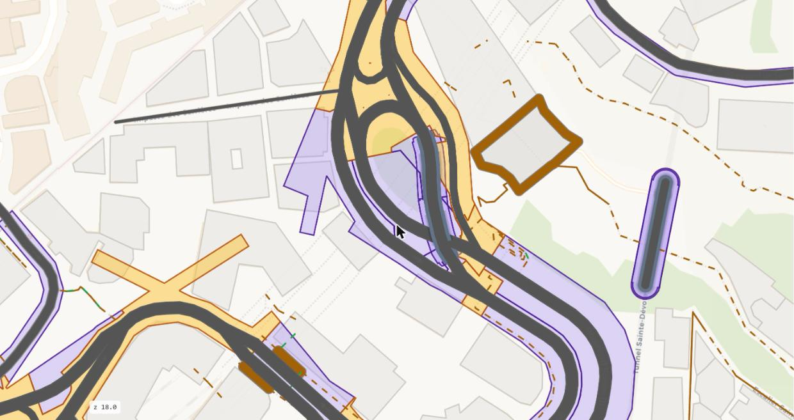
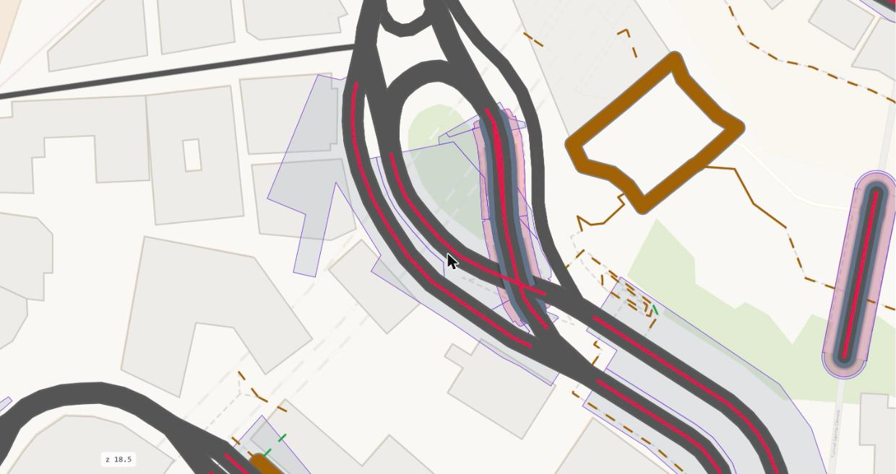

# Rank 2: the stretches

The street of a level divided along the road network into sections, from junction to junction, and intersections,
where the arms of one or more junction nodes meet. A section is cut into subsections where its cross-section changes.

## Reads

The road network of the level: duckOSM's driving edges with OSM's tags (`lanes`, `lanes:forward`, `lanes:backward`, `oneway`, `width`,
`turn:lanes`, `parking:*`, `cycleway*`). The street of rank 1. The bridge profiles, for the ways a bridge model draws.

## The junction nodes

A junction node is an OSM node where three or more road ends meet. A road that runs through the node counts two ends. The ends are
paired into streams: an end continues into the most opposite end within 45°. The node is a junction in three cases:

- an end has no continuation (a road ends there, a T junction);
- two ends continue into one (a merge or a fork: a Y, a ramp that joins a road, a slip lane that leaves a road);
- two streams cross (their ends alternate round the node).

Two streams that only touch, as two one-way lines of one street drawn into one node, make no junction. A node that only the ways of
a bridge and the ramps from it reach is the bridge's node, not the ground's. A landing keeps its junction, because a road of level 0
is there. Two roads that share no OSM node stay apart, also where they touch.

## The connectors

A road piece between two junction nodes that is shorter than 40 m, or any `_link` piece between them, is a connector. A connector
belongs to one intersection together with both nodes. An intersection can hold several nodes and connectors.

## The runs and the sections

A run is one OSM way with one cross-section, split at the junction nodes. A section is the road from one junction to the next,
whatever OSM ways it is made of: the runs chained end to end across every node that is no junction. Every section ends at every
junction it reaches. The longest way names the section (`s0-w<way>`); a second chain of the same way gets `.2`.

**A divided road is one section.** Two runs pair when all of these hold: both are one-way; both carry the same name; they lie side
by side (the middle of each line projects onto the inside of the other, 2 m or more away from it; each end of each line is within
30 m of the other line; the lines stay within 30 m over 80 % of their length); no block lies between their lines. The pair is one
section and one space. Each carriageway keeps its own lanes and kerbs on its own line. The median between them is an island of the
space. Two one-way streets of one name with buildings between them stay two sections. A boulevard whose carriageways are more than
30 m apart stays two sections, and the land between them is green of rank 1.

## The subsections and the change classes

A section is cut into subsections where the paint differs: a lane count, a turn pocket, a parking strip, an island. The id is
`<section>/<k>`. Every place along a section where OSM's tags change is classified before it touches anything (`space.change`, check
J4):

| Change in the data | Class | The frame | Inside the frame |
|---|---|---|---|
| the total is the same, the split between the directions differs | turn pocket | no change | the centre line moves over 15 m |
| the total changes by the lanes of a road that merges or forks at a node | merge, fork | no change | the lane blends into the neighbour at the node |
| the total changes with `turn:lanes` naming a turn lane within 80 m of an intersection | turn pocket | no change | the median or the parking narrows for the pocket |
| a parking tag or a city's meters start or stop | parking | no change | the parking strip starts or stops |
| a median, an island way, a barrier way or a bridge's barrier starts | island | no change | a strip inside the frame |
| the total changes, none of the above, and OSM `width` changes with it on both sides | real | the frame changes, with a kerb taper over 15 m | |
| the room between the street's edges changes the frame | room | the frame changes at the joint | |
| the total changes, none of the above, no width evidence | unknown | the frame keeps the wider count | the lane ends; paved roadway beside it |
| the lanes, the width and the strips are the same | none | no change | |

A merging or forking arm is an arm of another section at a junction node within 80 m along the section, whose heading continues
into the section within 45° and whose lanes are the difference. A real change needs OSM `width` on both sides, differing by more
than 0.5 m, or by more than 0.1 m a lane with the same count. A turn pocket named by `turn:lanes` gets no parking from the city's
meters on its kerb side; parking OSM maps on the way stays.

## The intersections

One intersection per junction node, or per cluster of nodes that connectors join: `i0-<node>`, the smallest node id. Its area is the
space of rank 3. Its nodes are in `space.junction`.

## The paths

A path is a street for walking. A path junction node is a node where three or more path ends meet, or where a path meets a road. A
path section is the path from one path junction to the next (`p0-w<way>`); a path intersection is where the paths meet
(`q0-<node>`). A square is the path intersection of the paths that reach it: their sections end at its edge. A square that no path
reaches is a plain piece of its plot. Where a path meets a road, the path section ends at the street's edge, and a crossing over the
road is the street's crosswalk.

## The named street

A named street (`k0-<way>`, `space.street`) is a group of stretches: the sections that share a name and a node, with the
intersections they arrive at. An unnamed road is its own named street. It is not a rank: an intersection belongs to every named
street that arrives at it.

{ width=100% }

*The sections (blue) and the intersections (red).*

{ width=100% }

*The subsections of the sections, with the breaks where the cross-section changes and the axis of each.*

## Writes

`space.stretch`: one row per section, intersection, path section and path intersection, with its ways, its nodes and its axis.
`space.junction`: the junction nodes of each intersection. `space.change`: every tag change along a section with its class and the
lanes on both sides. `space.street` and `space.arm`: the named streets and their arms ([The tables](tables.md)).

## Checks

| Check | Tests |
|---|---|
| J1 | every intersection holds a junction node |
| J2 | no intersection has a piece over 40 m² and over a tenth of its area outside its arms' bands |
| J3 | every connector lies inside an intersection or on a bridge deck |
| J4 (INFO) | the tag changes along the sections, with the count per class |
| K1 (INFO) | the kerb of a subsection against the city's catch basins: a difference over 1.5 m |
