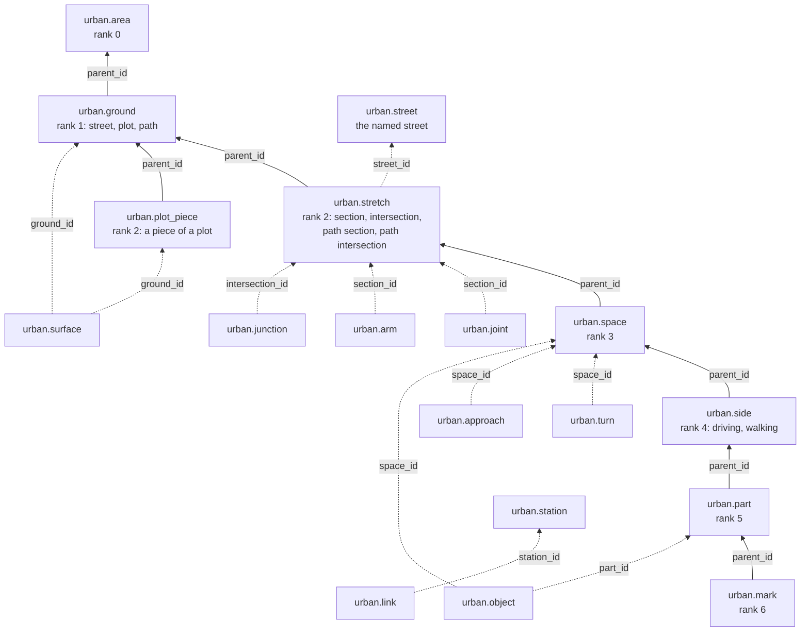

# The tables

<p class="lead">The model is the schema `urban`: one table per rank, and some tables that lie beside the ranks. Every row of a rank
table names its parent in the rank above, and the rows of one parent partition it. Every value from a source names the source and
the method.</p>

## How to read this chapter

The model is the `urban` schema of an area's DuckDB file. A reader uses this schema only. The build makes its intermediate results in
a second schema, `work`, and its last step writes `urban` from them ([The working schema](#the-working-schema-work)).

The model is a tree of seven ranks, from the area (rank 0) down to the marks (rank 6). [The model](model.md) names the ranks. Each
rank has a table. Each row has a `parent_id`: the id of the row in the rank above that holds it. The rows of one parent have no gap
and no overlap between them.

The diagram shows the tables. An arrow goes from a table to the table that its column names. The rank tables run down the middle. The
tables on the right are not ranks and have no `rank` column. Each of them points to a row of a rank table.



Six more tables describe the model and the build, not the street: `urban.item`, `urban.meta`, `urban.check`, `urban.registry`,
`urban.style` and `urban.code` ([The data about the data](#the-data-about-the-data)). The table `urban.element` is the input of the
build. The ranks are made from it.

### Follow one lane up the tree

Take the lane `s0-w473754701.2/2#3`. Each `parent_id` gives the next row up:

| Rank | Table | Id | What it is |
|---|---|---|---|
| 5 | `urban.part` | `s0-w473754701.2/2#3` | the lane (kind lane) |
| 4 | `urban.side` | `s0-w473754701.2/2:d` | the driving side that holds the lane |
| 3 | `urban.space` | `s0-w473754701.2/2` | the second subsection of the section |
| 2 | `urban.stretch` | `s0-w473754701.2` | the section, the second chain of way 473754701 |
| 1 | `urban.ground` | `g0-street-1` | the street of level 0 |
| 0 | `urban.area` | `a0` | the area of level 0 |

The ids of the part and the side start with the id of the space, and the id of the space starts with the id of the section ([The
ids](model.md#the-ids)). The `space_id` of the lane is `s0-w473754701.2/2` as well. A query can use it to skip the rows between.

The section belongs to the named street `k0-473754701` (`street_id` of `urban.stretch`). The named street is a group, not a parent.

### Query the tree

The view `urban.item` holds every rank in one list. Join it to itself on `parent_id` to go up. The key of the view is `id` with
`rank`, because an intersection is both a stretch and a space with one id. Join on `rank` too.

```sql
-- every lane of level 0 with the space that holds it, through its side
SELECT lane.id AS lane, space.id AS space
FROM urban.item AS lane
JOIN urban.item AS side  ON side.id  = lane.parent_id AND side.rank  = 4
JOIN urban.item AS space ON space.id = side.parent_id AND space.rank = 3
WHERE lane.rank = 5 AND lane.kind = 'lane' AND lane.level = 0;
```

A rank table has more columns than the view. Use `kind` to pick the parts of one type:

```sql
-- the parts of level 0 by kind, and the lanes of one subsection from the right
SELECT kind, count(*) AS parts FROM urban.part WHERE level = 0 GROUP BY kind ORDER BY parts DESC;
SELECT part_id, direction, lane, width_m FROM urban.part
WHERE space_id = 's0-w473754701.2/2' AND kind = 'lane' ORDER BY t_from;
```

### The conventions

- Geometry is stored in lon/lat (EPSG:4326). The build measures in the area's UTM zone.
- `level` is the integer level, -2 to 2.
- The columns `source`, `method` and `ref` say who gave a row, how they got it and which of their items it is ([Sources and
  provenance](sources.md)).
- A column that ends in `_m` is in metres. A column that ends in `_m2` is in square metres.
- A column with no value for a row is empty (NULL). A value that no source gives and no rule makes is not filled in.

## The common columns

The rank tables are `urban.area`, `urban.ground`, `urban.stretch`, `urban.plot_piece`, `urban.space`, `urban.side`, `urban.part` and
`urban.mark`. Each has the same columns in the same order. The thing's own values stand between `name` and `source`.

| Column | Type | Meaning |
|---|---|---|
| `<thing>_id` | VARCHAR | the readable id of the thing ([The ids](model.md#the-ids)) |
| `kind` | VARCHAR | what the thing is, one word from the rank's list |
| `rank` | INTEGER | the rank, 0 to 6 |
| `parent_id` | VARCHAR | the id of the thing of the rank above that holds it; none for the area |
| `level` | INTEGER | the level |
| `name` | VARCHAR | the thing's name, from its source |
| the thing's values | | its widths, its lengths, its lanes, with `<value>_source` and `<value>_method` where a value has a source of its own |
| `source` | VARCHAR | who gave the row |
| `method` | VARCHAR | how the source got it |
| `ref` | VARCHAR | which of the source's items it is, or the items the row was made from |
| `geometry` | GEOMETRY | the thing: one polygon for a thing of rank 1 to 5, a line or a shape for a mark |

Each `<thing>_id` is unique in its table. An intersection is both a stretch and a space, so the key of `urban.item` is the id with
the rank. A thing with a profile in the registry has one more column, `uid`, its stable id ([The registry](#the-registry-urbanregistry)).

The other tables (`urban.element`, `urban.joint`, `urban.street`, `urban.arm`, `urban.junction`, `urban.turn`, `urban.approach` and
the tables on the tree) have only the columns that their sections list.

## Rank 0

### `urban.area`

The whole area of a level: one row per level. It is the root of the tree, so its `parent_id` is empty.

| Column | Type | Meaning |
|---|---|---|
| `area_id` | VARCHAR | `a<level>` |
| `kind` | VARCHAR | area |
| `rank` | INTEGER | 0 |
| `parent_id` | VARCHAR | none |
| `level` | INTEGER | the level |
| `name` | VARCHAR | the area's name: the name of its file |
| `source` | VARCHAR | `osm` when OSM's boundary gives the area; `urbanstyle` when the box round the elements gives it |
| `method` | VARCHAR | `mapped`; `chosen` |
| `ref` | VARCHAR | the boundary, or the box |
| `geometry` | GEOMETRY | the area, one polygon |

### `urban.element`

The input of the build, as duckOSM gives it: one row per piece of a road, walkway, cycleway or rail line, per building and per
off-street car park. An element is not a rank. The build makes the ranks from the elements.

| Column | Type | Meaning |
|---|---|---|
| `element_id` | VARCHAR | `w<way>` for a piece of a way, `w<way>.<n>` for its further pieces; the source's id for a building or a car park |
| `kind` | VARCHAR | road, walkway, cycleway, rail, building, lot |
| `class` | VARCHAR | OSM's `highway`, `railway` or `building` value |
| `subtype` | VARCHAR | OSM's `footway=*` or `service=*` |
| `name` | VARCHAR | the name |
| `osm_id` | BIGINT | the OSM way |
| `source_id` | VARCHAR | the source's own id |
| `uid` | VARCHAR | a building's stable id, from the registry |
| `oneway` | BOOLEAN | one-way, from OSM |
| `lanes_forward` | INTEGER | the lanes along the way's direction, from duckOSM's edge in that direction |
| `lanes_backward` | INTEGER | the lanes against it |
| `width_m` | DOUBLE | the width |
| `width_src` | VARCHAR | where the width comes from |
| `level_min` | INTEGER | the lowest level of the element |
| `level_max` | INTEGER | the highest level |
| `level_src` | VARCHAR | where the levels come from: layer, bridge, tunnel, floors, height, chosen |
| `floors` | INTEGER | a building's floors |
| `height_m` | DOUBLE | a building's height |
| `use` | VARCHAR | what a building is used for |
| `use_source` | VARCHAR | who says so |
| `use_method` | VARCHAR | how |
| `ground_use` | VARCHAR | what its ground floor is used for |
| `ground_source` | VARCHAR | who says so |
| `ground_method` | VARCHAR | how |
| `source` | VARCHAR | `osm`, or a city for a footprint OSM does not have |
| `geometry` | GEOMETRY | the line, or the footprint |

## Rank 1

### `urban.ground`

One row is one piece of the area of a level: the street, a plot (a block) or a path (a corridor). The three kinds partition the area
(checks G1 to G3).

| Column | Type | Meaning |
|---|---|---|
| `ground_id` | VARCHAR | `g<level>-street-<n>`, `g<level>-plot-<block>`, `g<level>-path-<corridor>` |
| `kind` | VARCHAR | street, plot, path |
| `rank` | INTEGER | 1 |
| `parent_id` | VARCHAR | the area |
| `level` | INTEGER | the level |
| `name` | VARCHAR | a path's name |
| `sides` | JSON | a plot: its street sides, each with its way, the way's name and class, the distance from the road line and what set it (sidewalks, carriageway, path width, building) |
| `width_m` | DOUBLE | a path: its width |
| `width_source` | VARCHAR | OSM, or urbanstyle |
| `width_method` | VARCHAR | mapped, or chosen |
| `source` | VARCHAR | `urbanstyle` |
| `method` | VARCHAR | `derived`: the street is the area less the blocks and the corridors |
| `ref` | VARCHAR | the block or the corridor |
| `geometry` | GEOMETRY | the ground item, one polygon |

At a level other than 0, which has no blocks, the street is the union of the level's spaces.

## Rank 2

### `urban.stretch`

One row is one stretch of the street or of a path: a section, an intersection, a path section or a path intersection. Its spaces
partition it.

| Column | Type | Meaning |
|---|---|---|
| `stretch_id` | VARCHAR | `s<level>-w<way>` (a second chain `.2`), `i<level>-<node>`, `p<level>-w<way>`, `q<level>-<node>` |
| `kind` | VARCHAR | section, intersection, path section, path intersection |
| `rank` | INTEGER | 2 |
| `parent_id` | VARCHAR | the street or the path of rank 1 that holds it |
| `level` | INTEGER | the level |
| `name` | VARCHAR | a section: the name of its ways; an intersection: the names of the streets that meet there, joined by ` / ` |
| `street_id` | VARCHAR | the named street a section belongs to |
| `ways` | VARCHAR[] | the OSM ways, `w<way>`, in order along the axis |
| `nodes` | BIGINT[] | a section: the junction nodes at its start and its end; an intersection: its junction nodes |
| `class` | VARCHAR | a section: the OSM class of its ways |
| `oneway` | BOOLEAN | a section: one-way |
| `length_m` | DOUBLE | a section: the length of its axis |
| `axis` | GEOMETRY | a section: its subsections' axes chained, from its start node to its end node; none for an intersection |
| `source` | VARCHAR | `urbanstyle` |
| `method` | VARCHAR | `derived`: the street cut by the stop lines |
| `ref` | VARCHAR | the ways, joined by `,` |
| `geometry` | GEOMETRY | the stretch's face of the street; its spaces partition it |

### `urban.plot_piece`

One row is one piece of a plot, inside its block. Rank 2 is the last rank of a plot. The pieces of one plot partition it.

| Column | Type | Meaning |
|---|---|---|
| `piece_id` | VARCHAR | `g<level>-<kind>-<ref>` |
| `kind` | VARCHAR | building, yard, alley, car park, construction site, green, water, rail, square, structure |
| `rank` | INTEGER | 2 |
| `parent_id` | VARCHAR | the plot |
| `level` | INTEGER | the level |
| `name` | VARCHAR | from the source |
| `width_m` | DOUBLE | an alley: its width |
| `width_source` | VARCHAR | OSM, or urbanstyle |
| `width_method` | VARCHAR | mapped, or chosen |
| `surfaces` | VARCHAR[] | the surfaces that cover it (`urban.surface`) |
| `source` | VARCHAR | `osm` for a mapped piece; `urbanstyle` for a yard or an alley |
| `method` | VARCHAR | `mapped`; `derived` |
| `ref` | VARCHAR | the way or the relation |
| `geometry` | GEOMETRY | the piece, one polygon |

### `urban.joint`

Not a rank table. One row per joint of a section: a place where OSM's tags change, with its class of change.

| Column | Type | Meaning |
|---|---|---|
| `section_id` | VARCHAR | the section |
| `level` | INTEGER | the level |
| `subsection_a` | VARCHAR | the subsection before the joint |
| `subsection_b` | VARCHAR | the subsection after it |
| `way_a` | VARCHAR | the way before |
| `way_b` | VARCHAR | the way after |
| `lanes_a` | VARCHAR | the lanes before |
| `lanes_b` | VARCHAR | the lanes after |
| `width_a` | DOUBLE | the width before |
| `width_b` | DOUBLE | the width after |
| `class` | VARCHAR | turn pocket, merge, fork, parking, island, real, room, unknown, none |
| `note` | VARCHAR | the evidence |
| `geometry` | GEOMETRY | the joint |

### `urban.street`

Not a rank table. A row is one named street: a group of stretches. No stretch has it as its parent.

| Column | Type | Meaning |
|---|---|---|
| `street_id` | VARCHAR | `k<level>-<way>` |
| `name` | VARCHAR | the name |
| `level` | INTEGER | the level |
| `sections` | VARCHAR[] | its sections |
| `intersections` | VARCHAR[] | the intersections that its sections arrive at |
| `geometry` | GEOMETRY | its sections and intersections, joined |

### `urban.arm`

Not a rank table. One row per section that arrives at an intersection.

| Column | Type | Meaning |
|---|---|---|
| `intersection_id` | VARCHAR | the intersection |
| `street_id` | VARCHAR | the named street of the section |
| `section_id` | VARCHAR | the section |
| `way` | VARCHAR | the section's way, `w<way>` |
| `level` | INTEGER | the level |

## Rank 3

### `urban.space`

One row is one space: one per subsection, per intersection, per path section and per path intersection. The spaces of one stretch
partition it. A space never spans two levels.

| Column | Type | Meaning |
|---|---|---|
| `space_id` | VARCHAR | `s<level>-w<way>/<k>`, `i<level>-<node>`, `p<level>-w<way>`, `q<level>-<node>` |
| `kind` | VARCHAR | subsection, intersection, path section, path intersection |
| `rank` | INTEGER | 3 |
| `parent_id` | VARCHAR | its stretch; an intersection's is the intersection itself, at rank 2 |
| `level` | INTEGER | the level |
| `name` | VARCHAR | its stretch's name |
| `axis` | GEOMETRY | a subsection: its piece of the section's axis; none for an intersection |
| `s_from` | DOUBLE | a subsection: where it starts along the section's axis |
| `s_to` | DOUBLE | where it ends |
| `width_m` | DOUBLE | a subsection: the frame's width |
| `oneway` | BOOLEAN | a subsection: one-way |
| `length_m` | DOUBLE | a subsection: the length of its axis |
| `left_extra` | DOUBLE | a subsection: the merge shift |
| `predecessors` | VARCHAR[] | the spaces before it ([The links](#the-links-of-spaces-and-lanes)) |
| `successors` | VARCHAR[] | the spaces after it |
| `source` | VARCHAR | `urbanstyle` |
| `method` | VARCHAR | `derived`: the stretch cut by its joints |
| `ref` | VARCHAR | the ways, joined by `,` |
| `geometry` | GEOMETRY | the space, one polygon |

### `urban.junction`

Not a rank table. One row per junction node of an intersection.

| Column | Type | Meaning |
|---|---|---|
| `intersection_id` | VARCHAR | the intersection |
| `node_id` | BIGINT | the OSM node |
| `level` | INTEGER | the level |
| `cluster_id` | VARCHAR | the cluster of nodes that its connectors join |

## Rank 4

### `urban.side`

One row is one side of a space: the driving side or the walking side. The two sides partition the space (check S1). An island is a
part of the walking side, not a side.

| Column | Type | Meaning |
|---|---|---|
| `side_id` | VARCHAR | `<space>:d`, `<space>:w` |
| `kind` | VARCHAR | driving, walking |
| `rank` | INTEGER | 4 |
| `parent_id` | VARCHAR | its space |
| `level` | INTEGER | the level |
| `name` | VARCHAR | none |
| `kerb` | GEOMETRY | the driving side: the line of its kerb |
| `kerb_source` | VARCHAR | who gave the kerb: OSM's sidewalk line, or urbanstyle |
| `kerb_method` | VARCHAR | measured from the sidewalk line, or derived from the lanes' edge |
| `source` | VARCHAR | `urbanstyle` |
| `method` | VARCHAR | `derived`: the side's parts joined |
| `ref` | VARCHAR | none |
| `geometry` | GEOMETRY | the side, one polygon |

## Rank 5

### `urban.part`

One row is one piece of a side, of one kind: a lane, a sidewalk, a crosswalk and so on. The parts of one side partition it.

| Column | Type | Meaning |
|---|---|---|
| `part_id` | VARCHAR | `<space>#<n>` |
| `kind` | VARCHAR | lane, paved, parking, no parking, shoulder, bus lane, cycle lane, junction area, crosswalk, cycle crossing, bridge deck, island, sidewalk, furnishing, frontage, driveway, verge, bus stop, bus zone, tree pit; a path's surface, steps, ramp, handrail, bollard |
| `rank` | INTEGER | 5 |
| `parent_id` | VARCHAR | its side |
| `level` | INTEGER | the level |
| `name` | VARCHAR | none |
| `space_id` | VARCHAR | its space |
| `arm` | VARCHAR | a lane of an intersection: the road it belongs to |
| `direction` | VARCHAR | a lane: forward or backward along the way, in or out of an intersection |
| `lane` | INTEGER | a lane: its number from the middle of the road, 1 the innermost |
| `lane_id` | VARCHAR | a lane: its GMNS id |
| `axis` | GEOMETRY | a lane or a band of a subsection: its middle line, in the direction of travel; none in an intersection, and none for a crosswalk, a driveway, a tree pit or a bus stop |
| `s_from` | DOUBLE | a part of a subsection: where it starts along the space's axis |
| `s_to` | DOUBLE | where it ends |
| `t_from` | DOUBLE | its right edge across the axis |
| `t_to` | DOUBLE | its left edge |
| `predecessors` | VARCHAR[] | a lane: the lanes before it ([The links](#the-links-of-spaces-and-lanes)) |
| `successors` | VARCHAR[] | a lane: the lanes after it |
| `width_m` | DOUBLE | its width |
| `width_source` | VARCHAR | who gave the width |
| `width_method` | VARCHAR | how: mapped, chosen, narrowed, derived |
| `length_m` | DOUBLE | its length |
| `position_source` | VARCHAR | what set its edge |
| `position_method` | VARCHAR | how |
| `position_ref` | VARCHAR | which item |
| `road` | VARCHAR | the name of the road a lane belongs to |
| `road_class` | VARCHAR | its OSM class |
| `speed` | VARCHAR | its speed limit |
| `surface` | VARCHAR | its surface |
| `lit` | VARCHAR | lit or not |
| `road_lanes` | VARCHAR | its lanes as OSM maps them |
| `oneway` | VARCHAR | one-way |
| `holds` | VARCHAR | what stands in it |
| `rule` | VARCHAR | the rules that apply: parking rates and hours, a timetable |
| `source` | VARCHAR | where the part comes from |
| `method` | VARCHAR | how |
| `ref` | VARCHAR | which item |
| `geometry` | GEOMETRY | the part, one polygon |

## Rank 6

### `urban.mark`

One row is one painted line, arrow, zebra or kerb line, on a part. Rank 6 is the last rank. A path has no marks.

| Column | Type | Meaning |
|---|---|---|
| `mark_id` | VARCHAR | `<space>:<kind>:<n>` |
| `kind` | VARCHAR | kerb, lane line, centre line, edge line, parking line, stop line, give-way line, zebra, crossing line, arrow, guide line, barrier |
| `rank` | INTEGER | 6 |
| `parent_id` | VARCHAR | the part it lies on; for the kerb line, the driving side whose border it is |
| `level` | INTEGER | the level |
| `name` | VARCHAR | none |
| `parent_rank` | INTEGER | 5, or 4 for the kerb line |
| `space_id` | VARCHAR | its space |
| `s_from` | DOUBLE | a mark of a subsection: where it starts along the space's axis |
| `s_to` | DOUBLE | where it ends |
| `t_from` | DOUBLE | its right edge across the axis |
| `t_to` | DOUBLE | its left edge |
| `width_m` | DOUBLE | its width |
| `width_source` | VARCHAR | who gave the width |
| `width_method` | VARCHAR | how |
| `length_m` | DOUBLE | its length |
| `source` | VARCHAR | where it comes from |
| `method` | VARCHAR | how |
| `ref` | VARCHAR | which item |
| `geometry` | GEOMETRY | its middle line, or its shape |

### `urban.turn`

Not a rank table. One row per lane-to-lane move through an intersection, from SUMO.

| Column | Type | Meaning |
|---|---|---|
| `space_id` | VARCHAR | the intersection |
| `level` | INTEGER | the level |
| `from_edge` | VARCHAR | the duckOSM edge it comes from |
| `from_lane` | INTEGER | the lane on that edge |
| `to_edge` | VARCHAR | the edge it goes to |
| `to_lane` | INTEGER | the lane on that edge |
| `turn` | VARCHAR | left, straight, right |
| `vehicles` | VARCHAR | the vehicles the move is open to |
| `condition` | VARCHAR | the time rule that binds it |
| `source` | VARCHAR | `sumo` |
| `geometry` | GEOMETRY | the guide line of the move |

### `urban.approach`

Not a rank table. One row per lane that comes into an intersection.

| Column | Type | Meaning |
|---|---|---|
| `space_id` | VARCHAR | the intersection |
| `level` | INTEGER | the level |
| `from_edge` | VARCHAR | the edge the lane is on |
| `lane` | INTEGER | the lane |
| `moves` | INTEGER | the moves that start in it |
| `ways` | VARCHAR | where they go |
| `arrow` | BOOLEAN | the lane has a turn arrow |
| `no_arrow_because` | VARCHAR | why it has none |

## The axes and (s, t)

Every linear thing has an `axis`: its middle line, from its start to its end. A section's axis is its subsections' axes chained. A
subsection's axis is its piece of the section's axis, from `s_from` to `s_to`. A lane's axis runs in its direction of travel: a
forward lane along the subsection's axis, a backward lane against it. An intersection has no axis.

A thing's place on its space's axis is `(s, t)`: `s` in metres along the axis from the start of the section, `t` in metres across
it, positive to the left ([The format](format.md), R4). `s_from` and `s_to` give the range along, `t_from` and `t_to` the range
across. The lanes of one subsection are ordered by `t_from`. A thing inside an intersection has no `(s, t)`.

## The links of spaces and lanes

`predecessors` and `successors` make the spaces and the lanes a graph for routing, as CityGML's `predecessor` and `successor` and
OpenDRIVE's links do.

- **A subsection:** its predecessor is the subsection before it in its section, or the intersection at the section's start; its
  successor is the subsection after it, or the intersection at the section's end.
- **An intersection:** its predecessors are the subsections whose successor it is, and its successors the subsections whose
  predecessor it is. The subsection of a two-way arm is both.
- **A lane at a joint:** its successor is the lane of the next subsection, in its direction of travel, with the same direction and
  the same number, that shares the joint with it. A lane that the next subsection does not have has no successor there (check R4).
- **A lane at an arm:** a lane of a subsection and the lane of the intersection that shares the stop line with it, on the same road,
  are linked in the lane's direction of travel.
- **A lane through an intersection:** its successors are the lanes where the turns that start in it end (`urban.turn`).

Each link has its reverse: a lane is the predecessor of each of its successors.

## Tables on the tree

These tables are not ranks and have no `rank` column. Each one points to a row of a rank table, or joins two levels.

### `urban.object`

What stands in the street: one row per real thing, matched from every source ([Street objects](objects.md)). Mapillary only confirms;
a thing that only Mapillary sees is not a row.

| Column | Type | Meaning |
|---|---|---|
| `object_id` | VARCHAR | the id in its best source: `n<node>`, `w<way>`, or the city's record id |
| `kind` | VARCHAR | `group.class` |
| `uid` | VARCHAR | its stable id, from the registry |
| `level` | INTEGER | the level it stands on |
| `space_id` | VARCHAR | the space it stands in, or the nearest space within 60 m |
| `part_id` | VARCHAR | the part it stands in |
| `near_m` | DOUBLE | its distance to that space, when it stands outside every space |
| `name` | VARCHAR | its name |
| `attrs` | JSON | a short set of attributes from its tags |
| `width_m` | DOUBLE | its width |
| `width_source` | VARCHAR | the source that measured it, or urbanstyle |
| `width_method` | VARCHAR | how, or chosen for its class |
| `height_m` | DOUBLE | its height |
| `height_source` | VARCHAR | the source that measured it, or urbanstyle |
| `height_method` | VARCHAR | how, or chosen for its class |
| `sources` | VARCHAR | every source that describes it, joined by `, ` |
| `refs` | VARCHAR | its id in each source, in the same order |
| `source` | VARCHAR | the best source |
| `method` | VARCHAR | the best source's method |
| `geometry` | GEOMETRY | the point, from the best source |

### `urban.link`

One row is one join between two levels at a node. The links are the only joins between levels.

| Column | Type | Meaning |
|---|---|---|
| `link_id` | VARCHAR | `<node>`; a second link at one node `<node>.2` |
| `kind` | VARCHAR | ramp, stairs, elevator, entrance, connection |
| `level_from` | INTEGER | the lower level |
| `level_to` | INTEGER | the upper level |
| `node_id` | BIGINT | the OSM node |
| `station_id` | VARCHAR | an entrance's station |
| `geometry` | GEOMETRY | the node |

### `urban.station`

A rail, subway or tram station.

| Column | Type | Meaning |
|---|---|---|
| `station_id` | VARCHAR | the source's id |
| `kind` | VARCHAR | the kind of station |
| `name` | VARCHAR | its name |
| `level` | INTEGER | its level |
| `geometry` | GEOMETRY | its point |

### `urban.surface`

One row is one surface that covers a ground item or a plot piece. The surfaces of one item cover it exactly (checks L1, L2).

| Column | Type | Meaning |
|---|---|---|
| `surface_id` | VARCHAR | `<item>:<kind>` |
| `ground_id` | VARCHAR | the ground item or the plot piece it covers |
| `kind` | VARCHAR | roadway, pedestrian realm, median, verge, building, car park, construction site, garden, yard, lawn, play, path, track bed, under bridge, paved, water |
| `level` | INTEGER | the level |
| `source` | VARCHAR | who gave it |
| `method` | VARCHAR | how |
| `ref` | VARCHAR | which item |
| `geometry` | GEOMETRY | the surface |

### `urban.observed`

Mapillary's detections, kept local, for validation only.

| Column | Type | Meaning |
|---|---|---|
| `feature_id` | VARCHAR | Mapillary's id |
| `kind` | VARCHAR | Mapillary's class |
| `group` | VARCHAR | the group it is matched in |
| `first_seen` | TIMESTAMP | the first photo that shows it |
| `last_seen` | TIMESTAMP | the last |
| `source` | VARCHAR | `mapillary` |
| `geometry` | GEOMETRY | its point |

### `urban.photo`

The positions of Mapillary's photos, kept local.

| Column | Type | Meaning |
|---|---|---|
| `photo_id` | VARCHAR | Mapillary's id |
| `captured` | TIMESTAMP | when it was taken |
| `compass` | DOUBLE | the direction of the camera |
| `is_pano` | BOOLEAN | a panorama |
| `sequence` | VARCHAR | its sequence |
| `geometry` | GEOMETRY | where it was taken |

## The data about the data

These tables describe the model and the build. The view `urban.item` is a list of the tree. The others say what made the database,
how to draw it and how its kinds map to the standards.

### `urban.item`

A view, not a table. It holds every rank in one list. A query over the tree joins the view to itself on `parent_id` (see [Query the
tree](#query-the-tree)). The objects, the links and the stations are not in it.

| Column | Type | Meaning |
|---|---|---|
| `id` | VARCHAR | the thing's id |
| `rank` | INTEGER | its rank |
| `kind` | VARCHAR | its kind |
| `parent_id` | VARCHAR | its parent |
| `level` | INTEGER | its level |
| `geometry` | GEOMETRY | its geometry |

### `urban.meta`

The manifest of a build. One row per fact about the build, so a database says what made it and from what.

| Column | Type | Meaning |
|---|---|---|
| `key` | VARCHAR | the name: `version`, `built`, `input.<name>`, `chosen.<module>.<NAME>` |
| `kind` | VARCHAR | build, input, chosen |
| `value` | VARCHAR | the value, as text |
| `note` | VARCHAR | an input: its date; a chosen value: what it is for, in the words of the code |

The chosen values are every value that no source gives, with the name that the code uses, so a reader finds each one in the code
([Sources and provenance](sources.md), method `chosen`).

### `urban.check`

One row per check of the last check run ([Checks](../reference/checks.md)).

| Column | Type | Meaning |
|---|---|---|
| `check_id` | VARCHAR | the check's id: `U1`, `G2`, `BR12` |
| `kind` | VARCHAR | fault, info |
| `status` | VARCHAR | pass, fail, info |
| `count` | INTEGER | the number of faulty things |
| `what` | VARCHAR | what the check counts |
| `items` | VARCHAR[] | where the faulty things are, `lon,lat` |
| `checked` | TIMESTAMP | when the check ran |

<a id="the-registry-urbanregistry"></a>

### `urban.registry`

The stable ids of the format's requirement R6 ([The format](format.md)). A thing with a profile is made only of facts that do not
change. It has one id for as long as the profile lasts. The registry is kept from build to build. A build reads the registry of the
database it replaces. It gives every profile it knows its id again, and it gives a new profile a new id.

| Column | Type | Meaning |
|---|---|---|
| `profile` | VARCHAR | the profile, as text: `osm:n13983466896`, `vancouver:vb6509215` |
| `uid` | VARCHAR | the id, a UUID |
| `kind` | VARCHAR | what the thing is: street object, building |
| `first_seen` | TIMESTAMP | the build that first had the profile |
| `last_seen` | TIMESTAMP | the build that last had it |

| Kind | Profile |
|---|---|
| street object | its best source and that source's id: `osm:n<node>`, `vancouver:<record>` |
| building | its source and that source's id: `osm:w<way>`, `vancouver:vb<id>` |

The thing's own row carries the id in `uid`. The readable id (`s0-…`, `i0-…`, `n…`) stays as the label. The registry keeps the
street objects and the buildings; [The format](format.md) gives the profiles of the other kinds.

### `urban.style`

How a viewer draws the model. One row per table and kind. The levels are drawn from the lowest up; inside a level, the things are drawn in
`draw_order`, lowest first ([Drawing the tables](drawing.md)).

| Column | Type | Meaning |
|---|---|---|
| `table` | VARCHAR | the table |
| `rank` | INTEGER | its rank; none for a table on the tree |
| `kind` | VARCHAR | the kind; for a street object, its group |
| `draw_order` | INTEGER | the place in the stack of one level: rank 0 at 0, rank 1 from 10, rank 2 from 20, and so on to the marks from 60; the street objects at 70, the links at 80 |
| `form` | VARCHAR | polygon, line, point |
| `colour` | VARCHAR | the fill of a polygon, the colour of a line or a point |
| `dash` | DOUBLE[] | a dashed line: the metres drawn and the metres left out |
| `raise_m` | DOUBLE | in 3D, the height of the kind's top above the ground of its level |

### `urban.code`

The codes of the standards. One row per kind of ours, with its code in each standard. An export reads this table. A reader of a
standard finds our kind in it.

| Column | Type | Meaning |
|---|---|---|
| `kind` | VARCHAR | our kind |
| `citygml` | VARCHAR | CityGML 3.0 |
| `opendrive` | VARCHAR | OpenDRIVE 1.9 |
| `opensidewalks` | VARCHAR | OpenSidewalks |
| `ifc` | VARCHAR | IFC 4.3 |

| Ours | CityGML 3.0 | OpenDRIVE | OpenSidewalks | IFC 4.3 |
|---|---|---|---|---|
| named street | `Road` | the roads of one name | none | `IfcRoad` |
| section, subsection | `Section` | a road, its lane sections | none | `IfcRoadPart`, `ROADSEGMENT` |
| intersection | `Intersection` | `junction` | the node | `IfcRoadPart`, `INTERSECTION` |
| lane | `TrafficSpace`, granularity `lane`; `TrafficArea` | lane, type `driving` | none | `TRAFFICLANE` |
| bus lane | `TrafficSpace`, usage bus | lane, type `bus` | none | `TRAFFICLANE` |
| cycle lane, cycle crossing | `TrafficSpace`, usage bicycle | lane, type `biking` | none | `TRAFFICLANE` |
| shoulder | `AuxiliaryTrafficSpace` | lane, type `shoulder` | none | `SHOULDER` |
| parking, no parking, bus zone | `AuxiliaryTrafficSpace` | lane, type `parking` | none | `PARKINGBAY` |
| paved, junction area | `TrafficSpace` | lane, type `driving` | none | `TRAFFICLANE` |
| island | `AuxiliaryTrafficSpace` | lane, type `median` | traffic island edge | `TRAFFICISLAND` |
| sidewalk, furnishing, frontage | `TrafficSpace`, function sidewalk | lane, type `walking` | sidewalk edge | `SIDEWALK` |
| driveway | `TrafficSpace`, function driveway | lane, type `walking` | sidewalk edge | `SIDEWALK` |
| crosswalk | `TrafficSpace`; `Marking` | `crossPath`; object `crosswalk` | crossing edge | `PEDESTRIAN_CROSSING` |
| bridge deck | `BridgePart` | object `bridge` | none | `IfcBridgePart`, `DECK` |
| kerb | `AuxiliaryTrafficArea` | lane, type `curb` | kerb node | `IfcKerb` |
| lane line, centre line, edge line, parking line | `Marking` | `roadMark` | none | `IfcSurfaceFeature` |
| stop line, give-way line, zebra, crossing line, arrow, guide line | `Marking` | `roadMark`; `object` | none | `IfcSurfaceFeature` |
| barrier | `AuxiliaryTrafficArea` | object `barrier` | none | `IfcRailing` |
| street object | `CityFurniture` | `object`, `signal` | point | `IfcSign`, `IfcSignal`, `IfcFurniture` |
| plot, plot piece, path | `LandUse` | none | none | none |
| building | `Building` | object `building` | building | `IfcBuilding` |
| level | `relativeToTerrain` | none | none | `VERTICAL` facility part |

## The working schema: `work`

The build does its steps in the schema `work`: the blocks, the corridors, the subsections, the cuts, the strips, the widths and the
first shapes of the spaces and the parts. A step reads what the steps before it wrote there. The last step of the build writes the
schema `urban` from `work`, table by table, as this chapter gives it. `urbanstyle check` tests the tables of `work` and writes its
results to `urban.check`. The [Tables
reference](../reference/tables.md) lists the tables of `work`.

## The bridge model

A bridge is not in the tables: it is a profile file, `<name>.bridge.json`, with the deck outline, the axes, the vertical profiles, the
sections, the bands and the piers, each value with its source and method ([Levels, bridges and tunnels](levels.md)). The server adds
`urban.bridge_part` in memory from the model, so the panel can find the model's lanes and paths.

## The pilot dossier

A pilot's dossier is its own database with the tables `unit`, `source`, `inventory`, `surface`, `line`, `object`, `match`, `lane`,
`movement`, `rule`, `observation` and `check` ([Sources and provenance](sources.md)).
