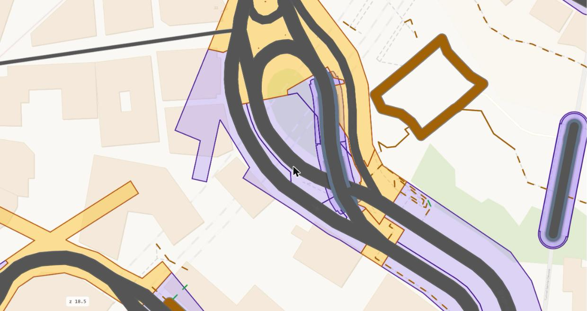

# Ranks 3 and 4: the units and their sides

The street of rank 1 cut into units, one per subsection and one per intersection, by the stop lines and the joints
alone. Inside each unit the kerb splits the driving side from the walking side.

## Reads

The street polygon of rank 1. The axes, the junctions and the change classes of rank 2. OSM's lanes, widths and sidewalk lines. OSM's
parking and cycle lanes, a city's meters and kerb evidence.

## Rank 3: each stretch cut into its units

1. **An intersection** is one unit: its face of rank 2, with its corners.
2. **A section** is cut by its joints: each joint between two subsections is run square to the road across the section's face, to
   its edges on both sides. The section's face noded with these cuts and polygonized gives its subsections, each one face. A section
   with no joint is one subsection.
3. **A cut** is clipped to the face it cuts and passes the face's boundary by 1 cm, so the noding joins them.

The unit of rank 3 is the face (`space.unit`): a subsection, `s0-w<way>/<k>`, or an intersection, `i0-<node>`. The subsections of a
section partition the section; the units of the level partition the street.

{ width=100% }

*The cuts, square across each arm at its stop line and at the joints: each piece of the street belongs to one section or one
intersection.*

**The paths.** A corridor is cut at its path junctions into one unit per path section and one per path intersection; a square is
one unit. A path's unit has one side, the walking side, and no kerb.

## Rank 4: the kerb and the two sides

**The frame.** A section has one frame: the lanes, both directions together, plus the parking, bus and cycle strips a source gives,
at the widest place of the section. The lanes are centred on the OSM line of the way they belong to. No line is moved sideways. A
merge or a fork is the one exception: the section whose lanes are the through arm's plus the merging arm's keeps the through arm's
kerb away from the merging arm, and its lanes sit half the merging lanes' width off the OSM line (`subsection.left_extra`). Where two
ways' lines are not aligned, the lanes jog inside the frame and the frame does not.

**The lane width.** Each lane is 3.25 m, a chosen value, or OSM's `width` shared by its lanes, between 2.5 m and 4.5 m. The lane
count is OSM's `lanes`, per direction from `lanes:forward` and `lanes:backward`. A two-way road with no count has one lane each way.
Where no source gives a lane width and the city's catch basins lie beyond the chosen lanes by 0.3 m to 3 m on a side, the outer lane
on that side widens to them as a lane that holds parking.

**The room.** The street's edge of rank 1 caps every kerb. For each run, the room on each side is the least distance from its line to
the blocks, the corridors and the sidewalk strips, measured every 2.5 m out to 60 m. The frame's kerb on that side never passes it.
Where the lanes and the strips do not fit between the two edges, the chosen lane width narrows on that piece, down to 2.75 m, the
count as OSM maps it (`width_method` `narrowed`). A width OSM maps is not narrowed. What still does not fit is cut at the edge. A joint
where the room changed the frame is the change class `room`.

**The sidewalk strip.** Every walkway at level 0 that is no crossing and has no corridor is a sidewalk line. Its strip is OSM's `width`
or 2 m, centred on the line. The near side of the strip is the kerb's limit; the far side is the block's edge. At a corner the kerb is
the line's curve where OSM maps it, and a 4 m fillet only where it does not.

**The driving side** is the part of the unit inside the kerb: in a section the frame between the two stop lines, in an intersection
the roadways of the arms to their stop lines, with the connectors' carriageways, joined, with the corners at the kerb.

**The walking side** is the rest of the unit, with the corners. A piece of the walking side that touches no block is an island of
that unit. An island begins where the strip between two frames is 2 m wide; a thinner tail with nothing on it is paved roadway, cut
off square. Inside an intersection a paved strip between roadways is junction area.

Every unit, with its parts and marks, is cut from the street of rank 1: the blocks and the corridors are taken out. So a unit never
reaches into a block.

## Writes

`space.unit`: one row per unit with its kind, its stretch, its axis, the frame's width and the merge shift. `space.side`: the
driving side, the walking side and the islands of each unit, the driving side with its kerb ([The tables](tables.md)).

## Checks

| Check | Tests |
|---|---|
| U1 | no two units overlap by more than 0.05 m² |
| U2 | every unit is one valid polygon |
| U14 | the units add up to the street, with a gap under 1 m² |
| B7 | no unit reaches into a block by more than 0.05 m², past a 2 cm hairline |
| B8 (INFO) | the units whose lanes narrowed to fit between the street's edges |
| S1 | the two sides of a unit add up to the unit, with no overlap |
| R1 | the roadway's edge steps at a joint only at a real change or a room change |
| A1 | the middle of a carriageway's lanes lies within 0.5 m of its OSM line |
