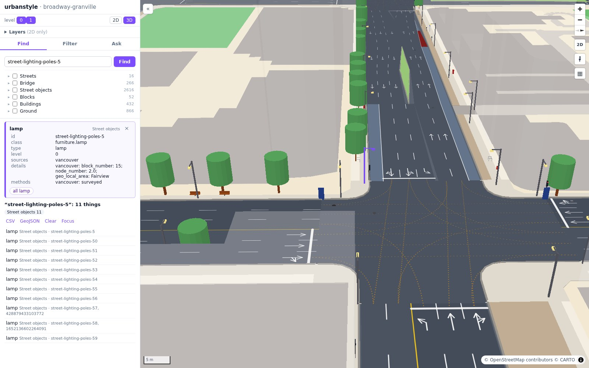

# Gallery

Pictures of West Broadway × Granville Street in Vancouver, taken from the dashboard.

Every picture is a screenshot of `urbanstyle serve` at 1600 × 1000. Map data © OpenStreetMap contributors, base map © CARTO; trees,
lamps and other street objects also from the City of Vancouver's open data.

## A street in focus

<small>Find → Streets → Granville Street, then **Focus**. The street's spaces, their parts and the street objects in them keep their
colors; the buildings that frame the street stay solid; the other buildings are see-through.</small>

## One intersection

<small>Search for `i0-7983078970`. The junction area, its sidewalks, kerbs and lane-to-lane guide lines in color; the four corner
buildings solid.</small>

## Close up: one lamp

<small>A lamp from the city's survey, selected in deep purple. The camera looks along its street, and the buildings are
see-through, so that no building hides it. Lanes, arrows, kerbs, trees and bus stops at their real size.</small>

## A filter in 2D

<small>Filter → Street parts, `type = sidewalk` and `width_m <= 1.8`. The results are orange; the selected sidewalk is deep purple,
and its card is in the panel.</small>

## Levels

<small>Level 0 faded, level 1 (Granville Bridge) in full.</small>

## Granville Bridge

<small>The bridge from its profile: its axes and lanes, paths, barriers, the steel truss and the piers, with deck heights from
LiDAR.</small>
