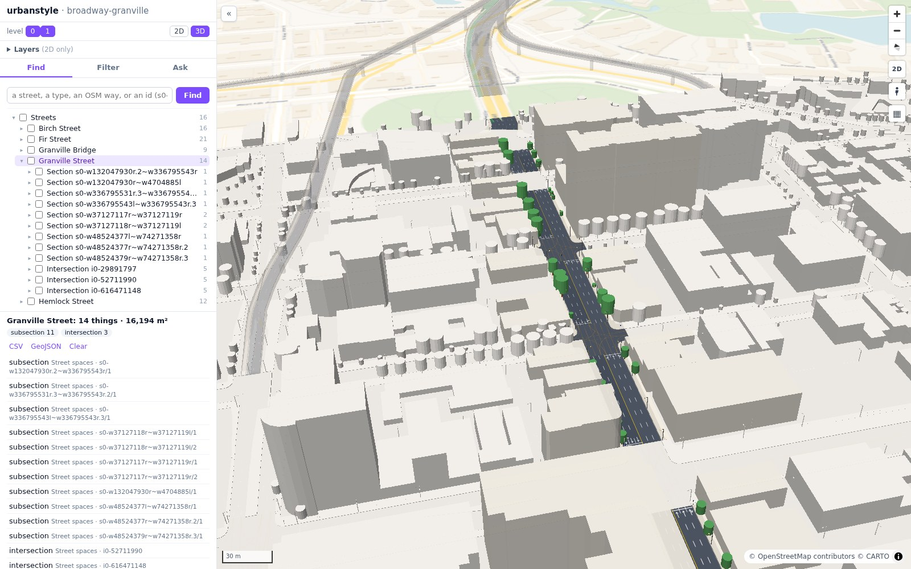
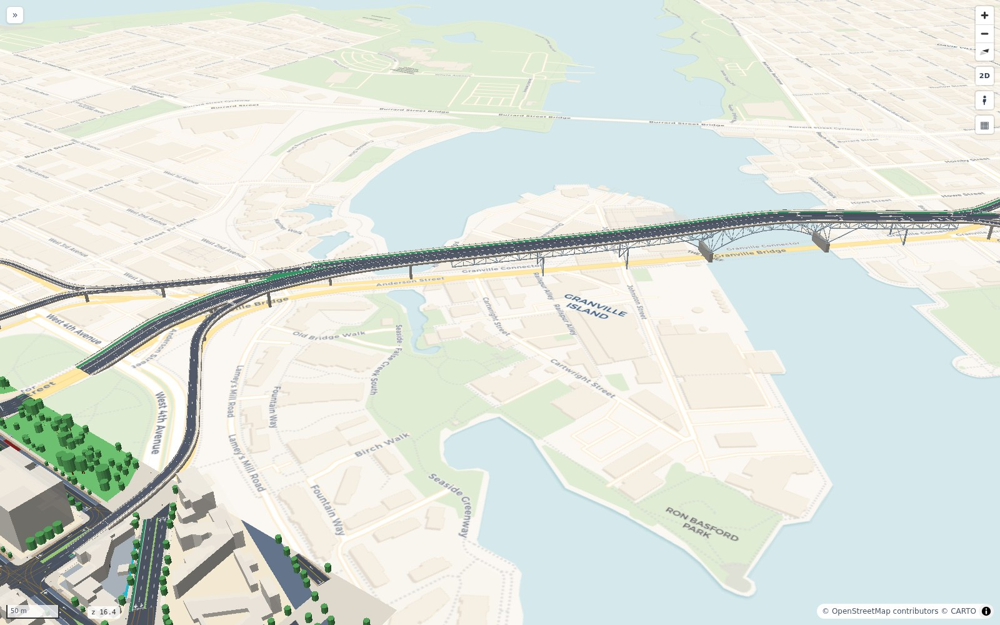

# urbanstyle

<p class="lead">An open format for city street space, and an open tool that builds it from open data.</p>


<small>Granville Street, Vancouver, in focus in the 3D view of the dashboard. Map data © OpenStreetMap contributors, base map © CARTO.</small>

urbanstyle takes the space between the buildings of a city and divides it the way a street engineer does. The street is the ground
outside the blocks. Each street is divided into sections and intersections, and each of these into its parts: lanes, shoulders,
medians, sidewalk zones, kerbs, crossings and painted lines. The street objects (lamps, trees, signs, benches, hydrants) stand in
it, and bridges carry it above the ground at their measured heights.

Every value names its source and how it was found: mapped in OpenStreetMap, measured from LiDAR, taken from a city's survey,
observed in street-level photos, or derived and chosen by urbanstyle. A planner can see why a sidewalk is 2.4 m wide, and fix the
source if it is wrong.

## What you get

- **The street space as areas, in 3D.** Sections, intersections, subsections and parts, at levels −2 … 2, with the links between
  levels. Bridges come from a profile with LiDAR heights.
- **One object for each real thing.** OpenStreetMap, the city's open data and Mapillary are matched, and each object keeps every
  source's id.
- **The source and the method of every value**, and checks that run on every build and link to each fault.
- **A dashboard for planners.** Find, filter and ask questions in plain words, in 2D and in 3D. A selected street, section or block
  is in focus, and everything else is faint.


<small>Granville Bridge, from its profile: lanes, paths, barriers, the steel truss and the piers. Map data © OpenStreetMap contributors, base map © CARTO.</small>

## Quick start

```bash
pip install "urbanstyle[dashboard,osm] @ git+https://github.com/Khoshkhah/urbanstyle"
duckosm build --pbf monaco-latest.osm.pbf -o monaco.duckdb -m driving -m walking -m cycling
urbanstyle build monaco.duckdb data/monaco.duckdb
urbanstyle dashboard data/monaco.duckdb viz/monaco.html
urbanstyle serve data/monaco.duckdb viz/monaco.html
```

Then open <http://localhost:8784/>. [Get started](get-started.md) goes through these steps one at a time.

## Status

Alpha. The pilot area is West Broadway × Granville Street in Vancouver, with Granville Bridge. The format is a set of agreed
requirements ([The format](design/format.md)): a profile of CityGML 3.0, written as a CityJSON Extension. The first version of its
specification and an export command come next, then a second city, Södermalm in Stockholm.

## Where to go next

| You want to | Read |
|---|---|
| build a first area and open it | [Get started](get-started.md) |
| do one task | the how-to guides: [build an area](how-to/build-an-area.md), [use the dashboard](how-to/use-the-dashboard.md), [ask questions](how-to/ask-questions.md), [check the data](how-to/check-the-data.md), [model a bridge](how-to/bridges.md) |
| look up a command, a table, an id or a check | [Commands](reference/commands.md), [Tables](reference/tables.md), [Ids](reference/ids.md), [Checks](reference/checks.md) |
| understand the model and its choices | [The street space](explanation/street-space.md), [Sources and accuracy](explanation/sources.md), [The format and the standards](explanation/standards.md) |
| read why a decision was made | the [design notes](design/index.md) |
