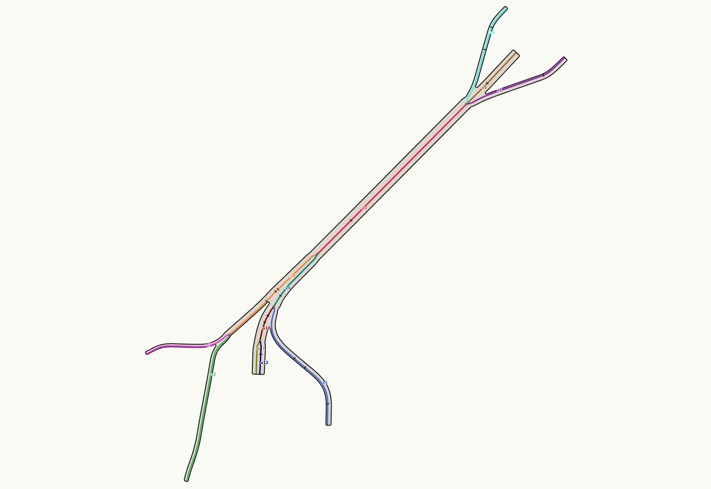
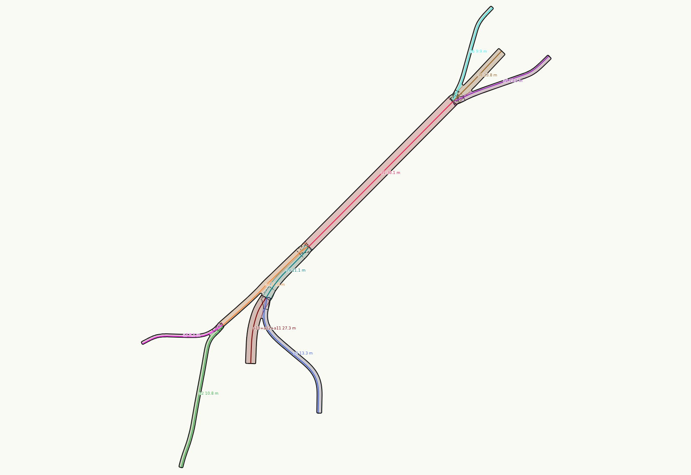
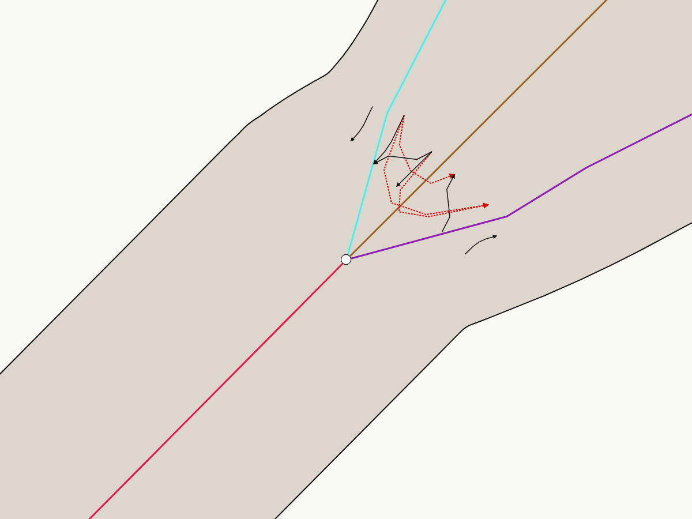
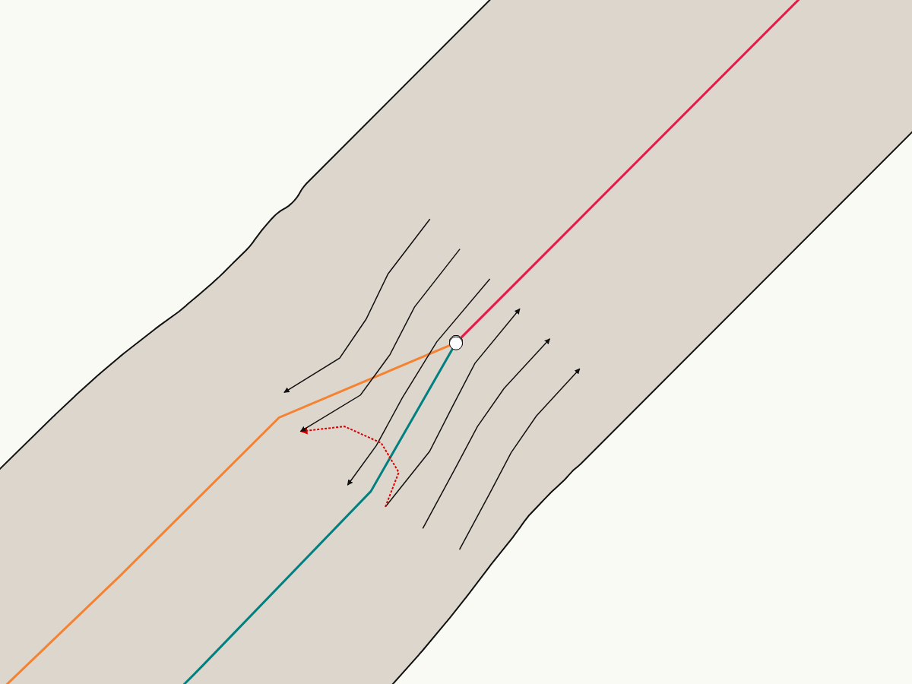
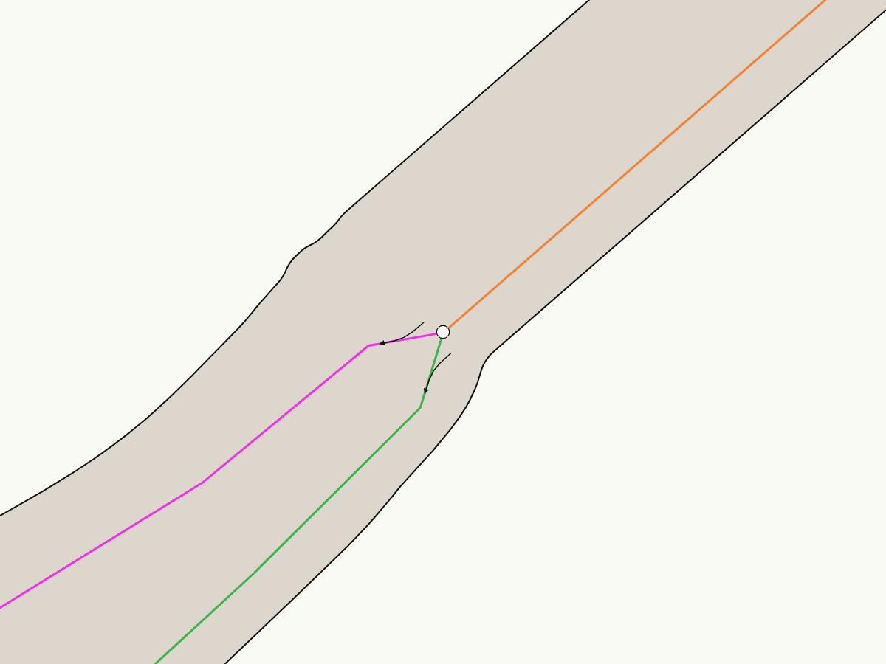
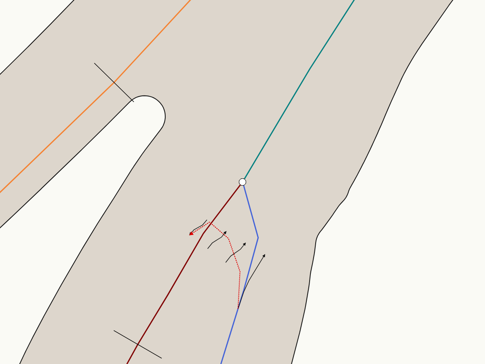
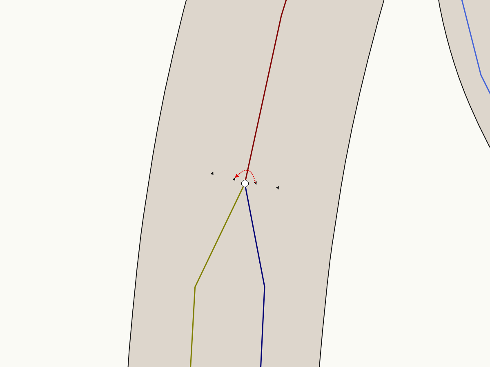

# How a bridge is split into parts

Status: this note describes the code at commit f2c0d37 (network-first) with the changes of 2026-10-19 (the plan page, the
carriageway width measured 20 m from the node: a10+a12+a11 one branch, the band links with no U-turn, the lane joints by the moves, and the path bands). It does not propose
a change. The example is Granville Bridge (`data/bridges-measured/granville-bridge.bridge.json`).

The code splits a bridge in four steps. Each step reads the result of the step before it.

| Step | Part | Rule | Code | Granville |
|---|---|---|---|---|
| 1 | bridge | one OSM `man_made=bridge` outline and the road ways on it | `bridge_profile.profiles` | 1 bridge |
| 2 | axis | the road ways, joined end to end, cut at each node where three or more road ends meet | `bridge_profile._profile` | 12 axes, 5 junction nodes |
| 3 | section | each axis cut at each end of a GMNS link | `bridge_profile._sections` | 32 sections |
| 4 | branch, structure | rank 0: axes chained into branches; the branches of one level joined into structures | `bridge_surface._branches`, `_structures` | 10 branches, 1 structure |

## Step 1: the bridge

- A bridge is one OSM way with `man_made=bridge` (the outline). Its road ways are the ways with `highway=*` and `bridge=*` where 60 %
  or more of the way is within 5 m of the outline (`ON_DECK`).
- A bridge must have at least one road way on it. A deck with only paths on it is not a bridge profile.
- Bridge ways that are not on an outline make one more bridge for each connected group of them.
- The ground nodes are the nodes of the roads that are not bridges. Paths (`cycleway`, `footway`, `path`, `pedestrian`) do not make ground
  nodes.

## Step 2: the axes

- The road ways of the bridge are joined at their shared ends (`shapely.line_merge`). Two ways join only where their two ends meet and no
  other road end is there.
- Thus an axis ends at a junction node (a node where three or more road ends meet: a fork or a merge), or at a free end. The word is
  the street's word (`docs/design/glossary.md`), with the same rule.
- The axes get the names `a1`, `a2`, ... from the longest to the shortest.
- Paths are not axes. They stay in the profile's `paths`, each along its own OSM line.



Granville's five junction nodes:

| Node | Axes that meet there | Where |
|---|---|---|
| n266729860 | a1, a5, a6, a8 | the north split (Howe, Seymour, the main span to the north) |
| n13040317836 | a1, a4, a9 | the south end of the main span |
| n414553095 | a2, a4, a7 | the west ramps (4th Avenue, Fir) |
| n3488072817 | a3, a9, a10 | the Granville Connector |
| n2625030369 | a10, a11, a12 | the Hemlock loop |

## Step 3: the sections

- Each axis is cut at each end of a GMNS link along it. Each section has the lanes of the links over its middle (`bands`).
- A GMNS link ends at each end of an OSM way. Thus a section can end where the lanes do not change. For example, a3 has 4 sections, each
  with 2 lanes.

| Axis | Length | Sections (from s0 to s1, number of lanes) |
|---|---|---|
| a1 | 550 m | 0-125 (6), 125-550 (6) |
| a2 | 404 m | 0-404 (2) |
| a3 | 368 m | 0-56 (2), 56-173 (2), 173-209 (2), 209-368 (2) |
| a4 | 312 m | 0-138 (2), 138-147 (2), 147-181 (2), 181-312 (2) |
| a5 | 306 m | 0-215 (2), 215-288 (2) |
| a6 | 306 m | 0-65 (2), 65-126 (2), 126-277 (2) |
| a7 | 246 m | 0-229 (1) |
| a8 | 246 m | 0-78 (4), 78-188 (4) |
| a9 | 179 m | 0-34 (5), 34-179 (4) |
| a10 | 96 m | 0-49 (5), 49-68 (5), 68-96 (5) |
| a11 | 90 m | 0-90 (2) |
| a12 | 89 m | 0-52 (3), 52-89 (3) |

(The lengths in the second column are the profile's. Rank 0 cuts the ends to the OSM bridge ends, so the sections can end before them.)

## Step 4: rank 0, branches and structures

- **Level:** each axis gets the level that most of its ways have (`work.element.level_min`). All 12 Granville axes are level 1.
- **Branch:** at each node, two axis ends join into one branch when all of these are true:
  - they go straight on: the cosine of the angle between them is more than 0.7;
  - they have the same level;
  - their widths differ by 3 m or less, or by 25 % or less of the wider one.
- **Carriageways:** two one-way branches from one junction node become one branch (`_merge_carriageways`) when all of these are true:
  - they run side by side, as near as their two widths;
  - they run together over 40 m or more (`PAIR_MIN_M`) and over 80 % or more of the shorter line;
  - the width they have 20 m to 30 m from the node (`PAIR_STEADY_M`) does not grow by more than 1 m.
  Nearer than 20 m to the node, the two lines still open out, so the width is not measured there. Two ramps that leave one node and
  then go apart (a9 and a4: 63 m together of 179 m) stay two branches.
- **Width:** each branch has one width: the widest of its axes (the lanes, the edge and the paths beside them).
- **Structure:** the branches of one level that touch make one structure. Where two axes are nearer than 4 m (`CUT_NEAR_M`) and their
  heights are more than 1 m apart (`CUT_DZ_M`), a slit cuts them apart and a wall stands there.



| Branch | Length | Width |
|---|---|---|
| a1 | 550 m | 30.1 m |
| a2 | 403 m | 10.8 m |
| a3 | 366 m | 13.3 m |
| a4 | 312 m | 16.0 m |
| a5 | 288 m | 13.5 m |
| a6 | 277 m | 9.9 m |
| a7 | 228 m | 8.1 m |
| a8 | 188 m | 23.8 m |
| a9 | 178 m | 21.1 m |
| a10+a12+a11 | 184 m | 27.3 m |

Granville has one structure: level 1, all 12 axes, 52,001 m².

## Which band goes to which band at a junction node

The profile has the links from band to band (`connectors`): SUMO's lane connectors, through duckOSM GMNS (`lane_connector`). Each
link has a lane in, a lane out and its line. `bridge_surface._moves` takes the links between two axes and gives each one its junction
node and its turn.

**A bridge has no U-turn.** A link that turns more than 90 degrees (`MAX_TURN_DEG`) is not a move, and the code leaves it out. OSM maps
no turn restriction at these nodes, so SUMO links each lane in to each lane out, also back the other way. (duckOSM's
`no-turnarounds` stops only a turn back onto the same road.) On Granville, each move turns 30 degrees or less, and each link that is left
out turns 113 to 141 degrees in SUMO's line (121 to 151 degrees between the OSM lines).

A band is written as axis, direction, lane: `f` is with the axis, `b` is against it, and the number is GMNS's lane number. For example,
`a1 b2` is lane 2 of a1, against the axis.

| Junction node | Moves (band in → band out) | Left out (turn) |
|---|---|---|
| n266729860 (north split) | a1 f2 → a8 f1; a1 f3 → a5 f2; a6 f1 → a1 b2; a6 f2 → a1 b3; a8 b1 → a1 b1; a8 b1 → a1 b2 | a6 f1 → a5 f1 (119°); a6 f1 → a8 f1 (120°); a8 b1 → a5 f1 (141°) |
| n13040317836 (south end of the main span) | a1 b1 → a9 b1; a1 b2 → a4 f1; a1 b3 → a4 f2; a9 f1 → a1 f1; a9 f2 → a1 f2; a9 f3 → a1 f3 | a9 f1 → a4 f1 (118°) |
| n414553095 (west ramps) | a4 f1 → a2 f1; a4 f2 → a7 f1 | none |
| n3488072817 (Granville Connector) | a10 f1 → a9 f1; a10 f2 → a9 f2; a3 f1 → a9 f3; a9 b1 → a10 b1 | a3 f1 → a10 b1 (126°) |
| n2625030369 (Hemlock loop) | a10 b1 → a11 f1; a10 b2 → a11 f2; a12 f1 → a10 f1; a12 f2 → a10 f2 | a12 f1 → a11 f1 (113°) |

Granville: 22 moves, 6 links left out. The links inside one axis (where two of its sections meet) are not in the table.

In the plan page, a move is a black arrow and a link that is left out is a red dashed arrow:

| | |
|---|---|
|  |  |
|  |  |
|  | |

The cover (`_cover`) uses the moves at the lane joints. Each lane end at a junction node joins one other lane end: the moves are
taken from the smallest gap up, and each lane end is used once. The two lanes meet at the middle between their ends, eased over 20 m
(`LANE_EASE_M`). A lane with no partner left begins or ends at the node. On Granville this makes 22 joins, and each one is a move in the
table.

### Sidewalks, cycleways and shared paths are bands too

A walking or cycling way is a band of its axis, the same as a lane (`bridge_surface._path_bands`):

- Each sidewalk, cycleway or shared path of the profile (`paths`) is a band. A crossing (`footway=crossing`) is not a band: it is a link
  across the lanes.
- Its line is its own OSM line, and its width is the path's width (2 m for a sidewalk with no `width` tag; the value is urbanstyle's).
- It belongs to the axis it runs beside, with its side (left or right) and its stretch `s0`-`s1`. A path that runs beside several axes
  gives one band to each, cut where it passes from one axis to the next. A stretch shorter than 5 m (`PATH_RUN_M`) stays with the axis
  before it.
- Two path bands are **connected** where they are pieces of one OSM way, or where their OSM ways share a node. Where they are
  connected, they join with no gap (a disc as wide as the narrower band). With no such source, they are not connected, and each band
  ends flat.
- In the cover, the lanes win where a path band reaches them. A barrier stands where a path band lies within 2 m of the driving side.
  The rest of the deck is paved.

On Granville: 43 path bands and 37 joints. The two main sidewalks run through the junction nodes as one OSM way each:
w871038559 on a7 → a4 → a1 → a6, and w538616396 on a3 → a9 → a1 → a5.

## The cover and the deck: general rules only (`bridge_cover.py`)

The cover of a bridge, and the deck it makes, come from the profile by general rules only. There is no corrections file and no rule for
one place. The old model (`bridge3d.py`) depends on `corrections/bridges.json` and `corrections/lanes.json`, and it is not used.

1. **A lane runs where SUMO runs it:** its band from `s_from` to `s_to` (GMNS `geom_cut`), at its offset `t`, as wide as its width.
   It runs on to its section's end where the next section of its axis goes on, at a fork or a merge (rule 2), at a ground end, and where
   SUMO's connector to the next lane is shorter than 2 m (`JOIN_M`). There the lanes meet.
2. **A fork or a merge** is a junction node where every move turns 30 degrees or less (`JOIN_ANGLE`). The trunk is the arm on the other
   side of the node from all the others, and it keeps its lanes. Each lane of another arm lies on the trunk lane its move names, carried
   straight on past the node, until its arm separates from the others (its lanes 0.5 m clear of theirs, `DIVIDER_M`). Then it eases to
   its own line over 40 m (`JOIN_BLEND_M`). A lane with no move there keeps its own line.
3. **At any other junction node** a lane ends where SUMO ends it, and SUMO's connector carries it on: a ribbon along the connector's line.
4. **No U-turn:** no move turns more than 90 degrees.
5. **Paths:** sidewalks, cycleways and shared paths are bands along their own OSM lines, joined where OSM joins them. A crossing
   (`footway=crossing`, `cycleway=crossing` or a `crossing` tag) is a crosswalk over the lanes: zebra bars, unless OSM says it is unmarked.
6. **The deck** of a level is all of these together, with gaps narrower than 3 m closed (`CLOSE_M`), plus 0.5 m (`EDGE_M`). It has no
   outline of its own. A hole of the deck narrower than 12 m is filled (no hole in a structure), and the cover paves it.

Paint: a lane line between two lanes of one direction, a centre line between the two directions (the two directions are found from each
lane's neighbours, because "forward" and "backward" belong to each axis), an edge line along the driving side, a guide line along each
connector ribbon, and an arrow on each lane every 100 m. A barrier stands between the driving side and a path band within 2 m of it.
There is no barrier between the two directions, because OSM maps none.

## What the pictures show

1. **Only the Hemlock loop is chained.** a10, a12 and a11 are one branch: a12 and a11 are the loop's two one-way carriageways, and
   a10 continues them straight on with about the same width. Every other branch is one axis. HANDOFF says that an earlier version
   made the main span a1+a8 one branch. The code does not chain them now. The cause is not examined yet.
2. **Some section ends are not lane changes.** They are OSM way ends (a3, a4, a6, a10). The frame model in `docs/notes/sections.md`
   cuts a section only at a real change.
3. **One structure.** All the decks are level 1 and they touch, so rank 0 makes one slab with one height surface.

## How to make the pictures again

The plan page draws the axes (group `ax`) and the branches (group `br`):

```bash
PYTHONPATH=src ../duckOSM/.venv/bin/python -m urbanstyle structure data/cuts/granville.urban.duckdb viz/cut-granville.bridge3d.json --bridge data/bridges-measured/granville-bridge.bridge.json --plan viz/plan-granville-parts.html
```

Then open `http://localhost:8784/plan-granville-parts.html`. For a picture with one group only, hide the other group with CSS
(`.br {display:none}` or `.ax {display:none}`).
