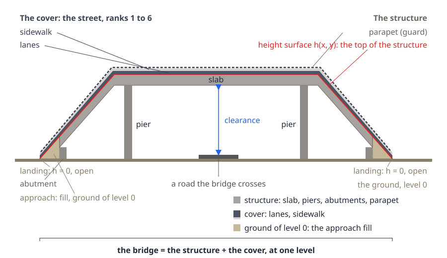
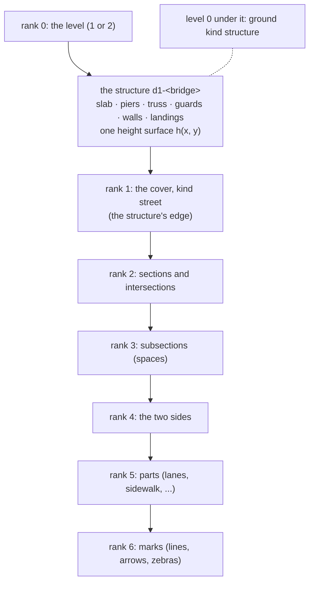
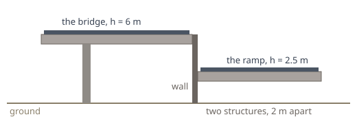

---
hide:
  - toc
---

# Bridges by rank

!!! note "Status: a proposal, not the current code"
    This note describes a **new** way to build bridges. The code does not do this yet.

    **Today:** each profile axis has its own height line. Each part takes the height of "its" axis. The 3D bridge is a separate
    engine (`bridge3d.py`) with its own lanes, guards and fills. Neighbours can disagree in height, and where they do the model
    shows a wall, a plate or a tilted piece.

    **Proposed:** the bridge is built like the street, top down by rank. The thing that carries (the structure) is one object
    with one height surface. The street on it (the cover) reads its heights from that surface and chooses nothing.

## The words

| Word | Meaning here |
|---|---|
| **level** | a floor of the model: 0 the ground, 1 and 2 above it, −1 and −2 below it |
| **bridge** | the structure and its cover together, at one level: the whole thing that carries a road or a path over something |
| **structure** | the bridge as a physical object: slab, piers, truss, guards (parapets), walls. One per bridge and level. It has one height surface. |
| **cover** | the street that lies on the structure: lanes, sidewalks, marks. It is the ground of its level (rank 1), and it is divided like the ground. |
| **abutment** | the support at each end of a bridge: the slab's end rests on it, and it holds back the fill of the approach behind it. Part of the structure. |
| **parapet** | the barrier along the bridge's outer edge, a wall or a railing, that stops people and cars going over the side. Part of the structure. The note also calls it the guard. |
| **guard** | the barrier along the structure's edge: the parapet, a wall or a railing (the profile's `deck.parapet`). Part of the structure. |
| **barrier** | a barrier inside the bridge, between the lanes and the sidewalk. Part of the cover (rank 5, type barrier), from OSM or a city's survey, like a kerb on the ground. |
| **approach** | the fill between the end of the slab and the landing, with its abutment. It carries the cover but it is ground of level 0, not structure. |
| **landing** | where the bridge's cover meets the street of level 0. The height there is 0. It is open: no guard, no wall. |
| **height surface** | h(x, y): the height of the structure's top at every point. The only source of a height on the bridge. |

## The idea

1. The structure gets one smooth height surface, from the whole bridge at once.
2. The cover is cut from the structure's edge and divided by the street rules, as on the ground.
3. Everything on the bridge is lifted by the surface. Nothing else sets a height.

<figure markdown>
{ width="100%" }
<figcaption>A bridge from the side, every part named: the structure and the cover together are the bridge. Structure: slab, piers, abutments, parapet. Cover: lanes and sidewalk, on the slab and on the approaches, down to the landings. The approaches (fill) are ground of level 0. The height surface (red) is the top of the structure; the cover reads it.</figcaption>
</figure>

## The tree of one bridge level

The cover and all ranks under it are made by the same code and the same rules as on the ground (`network.py`,
`street-rules.md`, `sections.md`). Only their heights differ: each vertex is lifted to h(x, y), plus the part's own raise
(a sidewalk 0.15 m).

## The height surface

Made once per structure, in two steps:

1. **Heights at the nodes.** One height for each node of the level's roads, all solved together:
   0 at every node on the ground; at least the clearance where the road crosses a lower way or a building; the grade along a
   road at most the agreed maximum; and, among all height sets that keep these, the smoothest one. Two roads that share a
   node share its height, so a fork or a merge has no step.
2. **The surface between the nodes.** One triangulated surface over the structure: the road lines every 2 m at their heights,
   and the edge at the height of the nearest road point. One triangulation per structure, so it is continuous by construction.

Where there is LiDAR, it sets the parameters of the rule, and its measured heights replace the chosen ones (as agreed).

## The rules

1. **One surface per structure.** No part, mark, guard, fill or pier chooses a height; all read h(x, y).
2. **Landings are at 0 and open.** Where the bridge meets the ground, the surface is 0, and there is no guard and no wall.
3. **Levels never touch.** Two structures of different levels cross; each keeps its own surface and the clearance between them.
   Two structures of one level never overlap.
4. **A ramp beside its bridge is its own structure.** Where two roads of one level lie closer than 4 m with heights more than
   0.5 m apart, the structure is cut between them. Each side gets its own edge, guard and surface, and a wall stands in the
   cut. A wall is then a real wall, never a fold in one surface.
5. **The structure comes from the profile only.** Its edge is OSM's `man_made=bridge` outline where OSM maps one, else the
   union of the level's sections as wide as their lanes and paths, plus the guard. A building, a plot or a city's data never
   limits it.
6. **The slab keeps its thickness.** Its top is h(x, y); its bottom is h − thickness. The slab ends at the abutment, where its
   bottom would reach the ground. From there to the landing the cover runs on the approach: fill that is ground of level 0.
   The slab never thins to a blade and never goes below the ground.

<figure markdown>
{ width="70%" }
<figcaption>Rule 4, seen across the road: a ramp 2 m beside its bridge and 3.5 m lower is a second structure, with a wall in the cut. One surface over both would be a slope steeper than 45°.</figcaption>
</figure>

## The checks

All six must be 0 on both test cuts before the model is called clean.

| Check | What is counted |
|---|---|
| D1 | triangles of a surface with an edge that no neighbour shares and that is not on the structure's edge (a hole, a tear) |
| D2 | triangles steeper than 45° inside a structure (a wall is allowed only in a cut, rule 4) |
| D3 | landing points higher than 0.1 m |
| D4 | clearances not met, each with its gap |
| D5 | vertices of the cover more than 0.01 m off the surface plus their raise |
| D6 | pairs of structures of one level that overlap |

## What changes in the code

| Today | Proposed |
|---|---|
| `bridge_profile.py`: one height line per axis, from the nearest ground node, with valley fill and dips | one solve for all nodes of the level, then one surface per structure (new module `deck_surface.py`) |
| `deck3d.py`: a part reads the nearest of its space's own axes; fills for strips no space covers | `deck3d.py` only samples the surface; no fills, because rank 2 partitions the cover |
| `bridge3d.py`: its own lanes, junction areas, guards and fills (3,300 lines) | removed |
| the page: one 3D layer per level | two layer groups per bridge, structure and cover, each with its own switch |

Tables: `space.structure` (one row per structure: level, bridge, edge, thickness) with `space.structure_part` (slab, pier,
truss, guard, wall, landing); `space.bridge_surface` (the triangles with their heights); `space.ground` gets the covers at the
bridge levels with their `structure_id`.

## The test

The two cuts (`scripts/cut.sh monaco france …`, `scripts/cut.sh vancouver granville …`), the six counts at 0, and the
pictures at the reported places: the Granville main span, its north forks and the Hemlock loop; Avenue de France's hairpin, the
crossing of a1 and a3, the ramp ends a7 and a9. The pictures go to `viz/review/` and are looked at before a link is sent.

## One open point: Saint-Roman

Avenue de France's hairpin node is the upper town's street on a hillside. With no terrain in the model, that node is at 0 m
and the bridges must come down to it at 18 %. The surface will be continuous there, but steep. The fix is a ground height per
node (terrain). That is a separate decision; this note does not depend on it.
